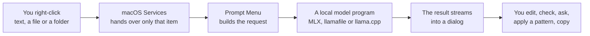
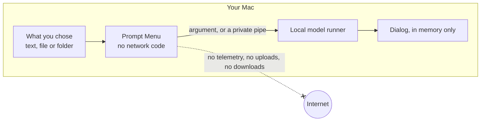

# Prompt Menu

**A right-click assistant for your Mac that runs entirely on your Mac.** Turn rough notes into prompts, bug reports, code review requests and commit messages, or get a plain-language explanation of any text, file, folder or database, using an AI model on your own machine.

## What it does

Prompt Menu adds six items to the macOS right-click menu, under **Services** in nearly every app and in Finder. It does two jobs:

**1. Rewrites what you've highlighted.** Select rough text anywhere (Notes, Mail, Slack, a browser, your editor), right-click → **Services → Rewrite as Agent Prompt**. A dialog opens and the result streams in:

```text
ROLE: …          who the agent should act as
OBJECTIVE: …     the exact outcome wanted
CONTEXT: …       facts from your text, nothing invented
STEPS: …         a numbered plan, ending with checking the result
CONSTRAINTS: …   what not to touch
DONE WHEN: …     checkable signs it's finished
```

Wherever your notes leave something out, the model writes `[CONFIRM: what to ask]` instead of guessing. Edit the result in the dialog, then **Copy** (⌘↩).

**2. Explains what you point it at.** Highlight text, or right-click anything in Finder, and choose **Explain This for Me**. That includes a folder, a `.db` file, a file with no extension, a PDF or a program. You get short, scannable sections: TL;DR · WHAT IT IS · HOW IT WORKS · KEY PARTS · WATCH OUT FOR · NEXT STEPS. Then ask follow-up questions right in the dialog.

## How it works



1. **macOS calls the app** when you pick a menu item. Nothing is running before that: no login item and no background process.
2. **The app prepares the input.** Text is used as it is. For something from Finder, the app works out what it really is from its contents, not its name, and writes a short description a text model can use (see [What it looks at in Finder](#what-it-looks-at-in-finder)).
3. **A model runner starts as an ordinary program** on your Mac, with instructions for the style you picked. There's no server, and Prompt Menu has no network code.
4. **The dialog shows the result as it's written.** Every version is kept while the dialog is open, a built-in check scores prompts without using a model, and you can ask follow-ups.
5. **The app quits when you're done.** With MLX, the model can stay loaded for a few minutes to make the next run fast, with a menu-bar icon showing it's there.

[docs/FLOW_MAPS.md](docs/FLOW_MAPS.md) has a diagram of every path, and [docs/ARCHITECTURE.md](docs/ARCHITECTURE.md) explains how it's built.

## Benefits

- 🔒 **Your text and files stay on your Mac.** No account, API key, cloud service or per-use cost. A test fails the build if network code appears in the app.
- 🖱️ **It works where you already are.** There's no new app to switch to and nothing to paste into a chat window.
- 🧠 **It understands more than text.** Folders, SQLite databases, PDFs, Word files, settings files, archives and programs all get a useful answer. Your own models can explain things they could never read as raw bytes.
- ✈️ **It works offline.** Once a runner and model are on your Mac, no connection is needed.
- 🧩 **You choose the model.** Use Apple **MLX**, Mozilla.ai's **llamafile**, or **llama.cpp**, with any suitable model you already have. The dialog lists what's on your Mac.
- 🧭 **Prompts agents can act on.** Agentic rewrites are real workflows: phases, each with a gate that must pass, plus a way to recover and a point to stop.
- ✅ **Fewer silent mistakes from small models.** The built-in check flags missing sections and dropped facts, and open questions are marked rather than guessed.
- ⚡ **Fast repeats.** The MLX model stays loaded for 5 minutes after use, so the next rewrite starts writing in under a second instead of about 10.
- 🪶 **Small and easy to inspect.** About 1.3 MB installed, about 4,800 lines of Swift, and no third-party dependencies. Built with the Command Line Tools, with no Xcode project.

## What you get

| Asset | What it is |
|---|---|
| **Six Services items** | Agent Prompt, Bug Report, Code Review Request, Commit Message, Replace Selection, and Explain This for Me |
| **The result dialog** | Streaming output, version history, editing, a model menu and Copy |
| **Follow-up chat** | An **Ask a follow-up** box in every dialog, with the text and result as context |
| **203 agentic patterns** | A built-in snapshot of [Awesome Agentic Patterns](https://github.com/nibzard/awesome-agentic-patterns), with a shortlist, search and code-owned phases and gates |
| **Deterministic check** | A score out of 100 for sections, dropped facts, open questions and a checkable finish, with no model involved |
| **Fill Gaps, Add Project** | Answer `[CONFIRM: …]` questions in place, and add a project's headings and commands to the context |
| **Compare Models, Review** | Run a draft on several models, then have them judge blind and harden the winner, with a Review Log |
| **Send To** | Start Claude Code, Codex, Gemini CLI, Aider or any CLI you add, in Terminal, in a folder you pick, with the prompt |
| **The item inspector** | Read-only summaries of folders, databases, documents, archives and binaries, built for a small model's limits |
| **Source and docs** | MIT-licensed Swift, 108 test functions that need no model, diagrams of every flow, and rules for AI agents working in the repo |

## The Services items

| Item | What you get |
|---|---|
| **Rewrite as Agent Prompt** | ROLE · OBJECTIVE · CONTEXT · STEPS · CONSTRAINTS · DONE WHEN, in a dialog |
| **Rewrite as Bug Report** | TITLE · SUMMARY · STEPS TO REPRODUCE · EXPECTED · ACTUAL · ENVIRONMENT · SCOPE |
| **Rewrite as Code Review Request** | CHANGE · CONTEXT · REVIEW FOCUS · OUT OF SCOPE · TESTING · DONE WHEN |
| **Rewrite as Commit Message** | An imperative subject of at most 72 characters, and a body that says what and why |
| **Rewrite as Agent Prompt (Replace Selection)** | The agent prompt, replacing the highlighted text directly, with no dialog. A small window shows progress. |
| **Explain This for Me** | An in-depth explanation of the highlighted text or code, or of any file or folder right-clicked in Finder (folders, `.db` databases, files with no extension, PDFs, binaries), in small easy-to-scan pieces: TL;DR · WHAT IT IS · HOW IT WORKS · KEY PARTS · WATCH OUT FOR · NEXT STEPS |

Every dialog has an **Ask a follow-up** box under the result. Ask anything about the text or the result; each question is sent to the same local model with the highlighted text, the result as it is now (edits included) and the conversation so far. The conversation isn't saved.

### What it looks at in Finder

What an item is gets decided from its contents, so a database with no extension is still treated as a database, and a `.db` that isn't SQLite still gets an answer. Everything shares an 8,000-character limit, which suits small models on 8 GB Macs. A file or folder too big for that is sampled, not read whole.

| You choose | What the model is given |
|---|---|
| **Text or code, with any extension or none** | The text, including UTF-16 and older single-byte encodings |
| **A folder or app bundle** | Totals, common file types, largest and newest files, the layout, and the start of files that say what it is, such as the README or `package.json` |
| **A SQLite database, with any name** | Tables, columns, row counts and up to three sample rows per table, biggest tables first |
| **A PDF, RTF, `.doc`, `.docx` or `.odt`** | The document's text |
| **A binary property list** | The decoded settings |
| **A zip, tar, gzip, bzip2, xz or 7z archive** | The list of files inside. Nothing is unpacked |
| **An image** | Its type, size in pixels, date, and the text in it, read on this Mac with Vision |
| **A program or anything else** | Its type, size, date, first bytes and any readable fragments |

Expect a less exact answer when only details and fragments are available: the model works from those, and says what it couldn't see. Images are described by their details and their text, because a text model can't see the picture: a screenshot of an error works well, a photo less so. Choosing several items splits the limit between them.

### If macOS blocks a file

macOS doesn't let apps read some items without asking, such as those in another app's folder under `~/Library/Group Containers`. Explain This for Me then says so and offers **Choose…**. Pick the item there, and macOS can let Prompt Menu read it. Prompt Menu asks for no permissions of its own.

## The dialog

- **Versions.** Every result is kept: `1 · First draft`, `2 · Plan-Then-Execute Pattern`, `3 · Edited`… Pick any of them from the menu at the top left. Your edits are saved as their own version before a pattern is applied.
- **Check.** The badge shows a score out of 100 and the number of `[CONFIRM: …]` questions. Click it for the list of problems.
- **Agentic Pattern…** Shows five patterns that fit the prompt, starting with workflows for its kind of task (a bug fix, a migration, research, a review), plus a search over all of them. If the model is already loaded, it suggests one (★). **Apply** rebuilds the current text as phases, each with a gate that must pass before the next, plus a `WORKFLOW PATTERN:` line. The app writes the phases and gates, and the model adds your task's details, so the workflow is there even when a small model adds little. Every earlier version stays available.
- **Model menu.** Lists the models already on this Mac (MLX models in the Hugging Face cache, `.gguf` files in the model folders from settings), each labeled MLX or GGUF with its size, so the same model in two formats is clear. Picking one saves it and runs the last step again. If the saved model was deleted, the dialog says so and opens this menu instead of failing. Nothing is downloaded.
- **Fill Gaps…** appears when the text has `[CONFIRM: …]` questions. Answers replace their markers exactly, without a model; **Polish** optionally smooths the wording afterwards.
- **Add Project…** picks a folder and adds the headings and commands from its `AGENTS.md`, `CLAUDE.md` and README to the prompt's context. Nothing is read until you pick the folder.
- **Compare Models…** (in the Model menu) runs the first draft with each ticked model, one after another, after showing an estimate. Each result is a version labeled with its model, time and check score.
- **Review…** (in the Model menu) treats the versions as candidates. With two or more models, each one picks the best without seeing who wrote it, twice in reversed orders so position bias can't count. A model never counts for its own draft, models under about 7B count half, and the check votes too. Then the models harden the winner as security, scope and verifiability reviewers. An edit is kept only if the check score holds, no fact from your text is lost and nothing is repeated; kept edits become versions. **Review Log** shows every vote and each edit as a diff, kept or not. The log isn't saved.
- **Ask a follow-up** answers any question about the text or the result. Ask it to change something, and the change becomes a new version, whole, even when the model sends back only the section it changed.
- **Send To…** (rewrites only) starts a coding agent's CLI in Terminal, in a folder you pick or one of the last five, with the prompt as it's shown. Claude Code, Codex, Gemini CLI and Aider are listed when they're installed. **Copy Command** gives a command to paste into any terminal instead. See [Sending to an agent](#sending-to-an-agent).
- **Try Again** repeats the last step: the first draft, or the last pattern. **Copy** (⌘↩) copies the text as shown, edits included.

### Sending to an agent

The prompt isn't written to disk. **Open in …** puts it on the clipboard and opens a small script in Terminal that holds only the folder and the command: it reads the prompt from the clipboard with `pbpaste`, passes it to the CLI as one argument, and deletes itself. **Copy Command for …** copies a `cd … && claude '…'` command with the prompt quoted as one word, so nothing in it can run as a command.

Each CLI is data. To add one, or change the arguments of a built-in one, create `~/Library/Application Support/Prompt Menu/harnesses.json`:

```json
{"schema": 1, "harnesses": [
  {"name": "Claude Code", "program": "claude", "arguments": ["--model", "opus", "{prompt}"]},
  {"name": "My agent", "program": "my-agent", "arguments": ["--task", "{prompt}"]}
]}
```

An entry with the name of a built-in one replaces it; others are added. Each needs a `program`, found the same way as the model runners, and exactly one argument containing `{prompt}`. Check the CLI's own `--help` for its flags. Prompt Menu reads this file and never writes it.

## Requirements

- macOS 13 or later; Apple Silicon recommended (MLX needs it)
- Xcode Command Line Tools: `xcode-select --install`
- One runner and one model (see below)

## Install

```sh
git clone https://github.com/jdgiles26/prompt-menu.git
cd prompt-menu
scripts/install.sh               # builds into ~/Applications and registers the Services item
```

Then open **Prompt Menu** from `~/Applications` to pick a runner and model, and click **Try It**.

To remove it: `scripts/install.sh --uninstall`

If an item doesn't appear in the right-click menu, turn it on in **System Settings → Keyboard → Keyboard Shortcuts → Services**. You can give it a keyboard shortcut there too. In Finder, the item may be directly in the menu or under **Services**: that depends on how many services apply.

## Runners

| Runner | Program | Install | Model setting |
|---|---|---|---|
| **MLX** (default) | `mlx_lm.generate` | `pip install mlx-lm` | A Hugging Face repo id that's already downloaded, e.g. `mlx-community/Llama-3.2-3B-Instruct-4bit`. Download once with `mlx_lm.generate --model <id> --prompt hi`. |
| **llamafile** 0.10+ | `llamafile` | [mozilla-ai/llamafile releases](https://github.com/mozilla-ai/llamafile/releases) | A `.gguf` path, or leave empty and set a model-bundled `.llamafile` as the runner path. |
| **llama.cpp** | `llama-completion` | `brew install llama.cpp` | A `.gguf` path to an instruct model. |

Prompt Menu looks for the program on your `PATH`, in Homebrew's folders, `~/.local/bin`, `~/bin` and pip's `~/Library/Python/*/bin`. The settings window shows what it found; set a full path if yours is elsewhere.

**Which model?** On an 8 GB Mac, a 3B–4B instruct model at 4-bit (about 2 GB) is the practical size. Measured with Llama 3.2 3B: the first rewrite starts writing after about 10 seconds, and while the model stays loaded the next one starts in under a second; a full prompt takes 7–15 seconds. With 16 GB or more, 7B–9B models follow the outline, and pick patterns, noticeably better.

**Keeping the model loaded.** With MLX, the model stays in memory for 5 minutes after each use (about 2 GB for a 3B model) and a menu-bar icon shows while it's loaded. Click it to see the time left or choose **Unload Model Now**; Prompt Menu quits once nothing is open and the model is unloaded. Set the time in settings, or 0 to unload right after each rewrite. llamafile and llama.cpp always run once per rewrite.

**Status:** MLX and llama.cpp have been run end to end with real models. The llamafile command line is covered by tests but hasn't yet been run against a real model; reports welcome.

MLX runs with `HF_HUB_OFFLINE=1`, so Prompt Menu never downloads a model itself. Only what's already on disk is used.

## Settings

The settings window covers the runner, runner path, model and max tokens. Everything is also available from Terminal:

```sh
defaults write local.promptmenu backend mlx            # mlx | llamafile | llama.cpp
defaults write local.promptmenu model mlx-community/Qwen3-4B-4bit
defaults write local.promptmenu executable /opt/homebrew/bin/llama-completion   # empty = search
defaults write local.promptmenu maxTokens -int 1024    # 16–8192
defaults write local.promptmenu temperature -float 0.3 # 0–2
defaults write local.promptmenu systemPrompt "Rewrite the text as …"   # empty = built-in agent prompt
defaults write local.promptmenu keepLoadedMinutes -int 5                # 0–120; 0 = unload right away (MLX)
```

`systemPrompt` replaces the instructions for **Rewrite as Agent Prompt** and Replace Selection only; the other styles keep theirs.

## Privacy

Prompt Menu's main design goal is that nothing you give it needs to leave your Mac.



**What's in your favor**

- 🚫 **No network code in the app.** No `URLSession`, sockets, web views or local servers. A test scans `Sources/` and fails the build if any appear, and CI runs it on every push to `main` and every pull request.
- 🙈 **No telemetry, analytics or crash reporting,** and no account, sign-in or API key.
- 📴 **No downloads.** The app never fetches models or patterns. MLX and its worker run with `HF_HUB_OFFLINE=1`, and the pattern catalog is built in.
- 🔑 **No special permissions.** No entitlements or `*UsageDescription` keys, so no Accessibility, Screen Recording, Apple Events or Full Disk Access. A test enforces this too.
- 🎯 **It only sees what you act on.** macOS hands over the highlighted text or chosen items when you pick a menu item. The app doesn't watch your screen, clipboard or files.
- 🧽 **It doesn't keep your data.** Your text and the model's output aren't logged or written to disk, not even by Send To, which hands the prompt over by the clipboard. Versions, the chat and the Review Log live in memory and go away with the dialog.
- 💤 **Nothing stays running,** except a kept-loaded MLX model for the time you set (5 minutes by default, 0 turns it off), with a visible menu-bar icon and **Unload Model Now**. There are no login items or daemons.
- 📖 **Read-only on your files.** Explain never changes what it reads. Databases are opened in SQLite's immutable mode, so no locks, journal or `-wal` files are created beside them.
- 🤐 **Careful inside folders.** You chose the folder, not each file in it. So files with secret-looking names (`.env`, `credentials`, `*.pem`…) and anything containing a private key are listed by name but never opened. Links aren't followed, and online-only iCloud files aren't downloaded. Database columns with secret-looking names show as `(hidden)`.
- 🔍 **You can check all of this.** The source is small, open and has no dependencies, and you build it yourself.

**Limits worth knowing**

- **Runners are separate programs.** The promises above are about Prompt Menu. The runner and model are software you install, so trust them accordingly. MLX is forced offline; for the others, use a build you trust.
- **Other programs under your account can see the text during a run.** It's passed to one-shot runners as a command-line argument, which tools like `ps` can show while the model runs. The kept-loaded MLX worker uses a private pipe instead. The text never leaves your Mac either way.
- **The app isn't sandboxed.** It reads only what you choose, but that's the app's own behavior rather than a macOS-enforced limit, and it's ad-hoc signed when you build it.
- **Secret filtering is best effort.** It goes by names and private-key markers, so a secret in an ordinary file or column can still reach the local model. Something you choose directly is read as chosen, even if it looks secret.
- **Online-only files you choose directly** may be downloaded by macOS when opened, as with any app.
- **Send To hands the prompt to another program.** The agent CLI you pick runs in Terminal with its own settings and permissions, and may send the prompt to its provider's servers. That's the CLI's behavior, not Prompt Menu's, and it only happens when you choose it.
- **Local models make mistakes.** Treat an explanation as a starting point, particularly for anything it marks "(probably)".

## Documentation

| Doc | For |
|---|---|
| [docs/ARCHITECTURE.md](docs/ARCHITECTURE.md) | How it's built: modules, types, decisions |
| [docs/FLOW_MAPS.md](docs/FLOW_MAPS.md) | Diagrams of every flow: service call, rewrite, streaming, errors, settings, how Explain reads each kind of item, and where your data goes |
| [docs/DEVELOPMENT.md](docs/DEVELOPMENT.md) | Building, testing, debugging, releasing |
| [AGENTS.md](AGENTS.md) | Rules for AI agents working in this repo |
| [docs/AGENTIC_DEVELOPMENT.md](docs/AGENTIC_DEVELOPMENT.md) | Guardrails, what to touch and not touch, and the change-impact map |
| [docs/FEATURE_FUTURE.md](docs/FEATURE_FUTURE.md) | Designed but not built yet: comparing models, a multi-model review pipeline, a fill-the-gaps wizard, sending to an agent CLI |
| [CHANGELOG.md](CHANGELOG.md) | What changed in each version |

## Credits

The build layout, test runner and parts of the app shell are adapted from [Finder Menu](https://github.com/nikgrbn/finder-menu) by nikgrbn (MIT).

The agentic patterns are from [Awesome Agentic Patterns](https://github.com/nibzard/awesome-agentic-patterns) by Nikola Balic and contributors, used under the Apache License 2.0. `Resources/patterns.json` contains their titles, metadata and an excerpt of each Solution section; see `Resources/NOTICE-agentic-patterns.txt`.

## License

MIT. See [LICENSE](LICENSE).

## What's in this repository

| Path | What's there |
|---|---|
| `Sources/Core/` | The logic: styles, runners, the checker, patterns, chat and the item inspector. Fully tested |
| `Sources/PromptMenu/` | The AppKit app: Services entry points, dialogs and settings |
| `Resources/` | The Info.plist with the Services items, the MLX worker, and the pattern catalog with its license notice |
| `Tests/` | A small test runner and its tests, run with `scripts/test.sh`. They never need a real model or the network |
| `scripts/` | Build, test, install and pattern-refresh scripts |
| `docs/` | Architecture, flow maps, development guide, decisions and future designs |
