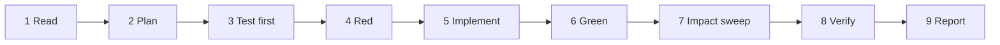

# Agentic development guide

How an AI agent (or a person) should make changes to Prompt Menu safely. [AGENTS.md](../AGENTS.md) has the hard rules in short form. This document explains them and maps every kind of change to what else it affects.

- [1. Workflow](#1-workflow)
- [2. Guardrails](#2-guardrails)
- [3. Touch map](#3-touch-map)
- [4. Change-impact map](#change-impact-map)
- [5. Recipes](#5-recipes)
- [6. Stop and ask](#6-stop-and-ask)
- [7. Verification and reporting](#7-verification-and-reporting)
- [8. Prompt template for tasks in this repo](#8-prompt-template-for-tasks-in-this-repo)

---

## 1. Workflow

Every change follows these steps in order. Don't skip one, and don't merge two together.



| # | Step | What it means here |
|---|---|---|
| 1 | **Read** | Read AGENTS.md, this file, and every file you'll change, in full. Find your change in the [change-impact map](#change-impact-map). |
| 2 | **Plan** | List the files you'll touch and the tests you'll add. If anything in [Stop and ask](#6-stop-and-ask) applies, stop now. |
| 3 | **Test first** | Add or change tests in `Tests/` that describe the new behavior. Register them in `Tests/main.swift`. |
| 4 | **Red** | `scripts/test.sh`. The new tests must fail (a compile error counts) for the reason you expect. |
| 5 | **Implement** | Make the smallest change to `Sources/` that makes them pass. Match the style of the code around it. |
| 6 | **Green** | `scripts/test.sh` prints `All tests passed.` and `scripts/build.sh build` succeeds. |
| 7 | **Impact sweep** | Go through the impact-map row again. Update each doc, plist key and script it names. |
| 8 | **Verify** | For UI or plist changes: `scripts/install.sh` plus the manual checks in [DEVELOPMENT.md](DEVELOPMENT.md#manual-checks). For runner changes: run against a real runner if one is installed. |
| 9 | **Report** | Say what changed, what you verified and how, and what you couldn't verify. |

## 2. Guardrails

### 2.1 Product promises: never break

| Promise | Enforced by | Notes |
|---|---|---|
| No network code | `testNoNetworkCode` | This includes localhost HTTP, `mlx_lm.server`, `ollama serve`, `llamafile --server`, and URL-loading APIs. A feature that needs the network is a product decision for a person to make, not a change to make here. |
| No downloads | `HF_HUB_OFFLINE=1` asserted in `testMLXInvocation` | Don't add "download model" buttons or auto-fetching. Tell users the Terminal command instead. |
| No permissions or entitlements | `testNoEntitlementsOrPermissions` | No Accessibility, Screen Recording, Apple Events, Full Disk Access or sandbox exceptions. |
| Text stays on the Mac and isn't logged | review | Don't `print`, `NSLog` or `Logger` the user's text or the model's output. Don't write them to disk. |
| Nothing stays running | `AppDelegate.finish()` | The app quits when no window is open. Don't add a menu-bar item, a login item or a background agent without asking. |

### 2.2 Engineering rules

1. **Command Line Tools only.** `swiftc` via `scripts/*.sh`. No Package.swift, Xcode project, CocoaPods, Carthage, or `import` of anything outside the macOS SDK.
2. **Swift 5 mode, macOS 13 target.** Don't raise either without asking. They appear in `build.sh`, `test.sh` and `LSMinimumSystemVersion`.
3. **`Sources/Core` imports Foundation only.** No AppKit, so the tests can cover it. UI code goes in `Sources/PromptMenu`.
4. **Logic belongs in Core.** If you're adding a branch or a calculation to a UI file, ask whether it can move into Core and get a test.
5. **Pass user text as one argv entry.** Never interpolate it into a shell string. Never use `/bin/sh -c`. (`/bin/sh <path> args…` for llamafile is fine: the shell runs the file with argv untouched.)
6. **One runner process per dialog.** Track it in `running`. Terminate it on Close and on Try Again. Ignore late results using `generation`.
7. **Touch AppKit on the main thread only.** `rewrite` runs on a background queue, and its `started` and `progress` callbacks arrive on background queues.
8. **`cleanOutput` must be safe on partial text** (it runs on every streamed chunk) and must stay cheap: it runs hundreds of times per rewrite.
9. **No new settings keys without the full sweep.** See [Change-impact map](#change-impact-map) → "Add a setting".
10. **Write comments that explain why, in full sentences, like the existing ones.** Don't add comments that repeat the code.

### 2.3 Rules for the tests themselves

- Never delete, skip or loosen an assertion to get a change through. If an assertion is truly wrong, change it in its own commit that says why.
- Tests must not depend on the network, a real model or runner, the user's `PATH`, the user's `local.promptmenu` settings, the current time, or the machine's speed (beyond generous timeouts).
- Every new behavior in `Sources/Core` gets a test. Every bug fix gets a test that would have caught it.
- Guardrail tests (`Tests/GuardrailTests.swift`) can only get stricter. Adding a word to `forbidden` is fine; removing one needs a person's approval.

## 3. Touch map

| Path | Status | Rule |
|---|---|---|
| `Sources/Core/*.swift` | ✅ **Change freely, test first** | Every change has a test. Foundation only. |
| `Sources/PromptMenu/ResultPanel.swift`, `SettingsWindow.swift` | ✅ **Change with care** | UI only. Do the manual checks afterwards. Keep `hidesOnDeactivate = false` and `orderFrontRegardless()`. |
| `Sources/PromptMenu/main.swift` | ⚠️ **Careful** | Launch timing (0.5 s), the activation policy and `finish()` decide when the app shows settings and when it quits. Re-check flows 1 and 10 in [FLOW_MAPS.md](FLOW_MAPS.md). |
| `Sources/PromptMenu/Service.swift` | ⚠️ **Signature frozen** | The method name and parameter labels must match the plist (`testServicesEntry`). The body can change. |
| `Resources/App-Info.plist` → `NSServices` | ⛔ **Don't change without asking** | Renaming `NSMenuItem` changes the menu for every user and resets their keyboard shortcut. Changing `NSMessage` needs matching code changes. |
| `Resources/App-Info.plist` → `CFBundleIdentifier` | ⛔ **Never** | `local.promptmenu` is also the settings domain. Changing it loses everyone's settings. |
| `Resources/App-Info.plist` → versions | ✅ only when releasing | Change both `CFBundleShortVersionString` and `CFBundleVersion` (see [DEVELOPMENT.md](DEVELOPMENT.md#releasing)). |
| `agentSystemPrompt` (in `Prompt.swift`) | ⚠️ **Careful** | Keep the six section names and `[CONFIRM`, which tests check. Wording changes reach every user who hasn't customized theirs. Before and after, try it on 3+ real notes with the default model and include the outputs in your report. |
| Settings keys (`backend`, `model`, `executable`, `maxTokens`, `temperature`, `systemPrompt`) | ⛔ **Don't rename or remove** | Users have saved values under them and the README documents them. Adding keys is fine (see recipe). |
| `Backend` raw values (`mlx`, `llamafile`, `llama.cpp`) | ⛔ **Don't rename** | They're saved in `backend`. Unknown values fall back to MLX, which would silently switch a user's runner. |
| `Tests/main.swift` helpers | ✅ add, ⚠️ change | Adding helpers is fine. Changing `check` or `checkEqual` affects every test. |
| `Tests/GuardrailTests.swift` | ⛔ **Only stricter** | See 2.3. |
| `scripts/build.sh`, `test.sh` | ⚠️ **Careful** | Keep `-swift-version 5`, the macOS 13 target and the ad-hoc signature. Keep compiler flags the same in both. |
| `scripts/install.sh` | ⚠️ **Careful** | It writes to `~/Applications` and refreshes system caches. Don't add `sudo` or write outside `~/Applications`. |
| `.github/workflows/ci.yml` | ⚠️ **Careful** | Keep both macOS versions. CI must never need a model, a runner or secrets. |
| `LICENSE` | ⛔ **Never** | It keeps Finder Menu's MIT notice, as the license requires. |
| `docs/*.md`, `README.md`, `AGENTS.md` | ✅ **Keep in sync** | Required by the impact map. `testDocsCoverEveryRunner` checks the runner lists. |
| `build/` | ⛔ **Never commit** | It's in `.gitignore`. |

## Change-impact map

**If you change the thing on the left, you must also update everything on the right in the same change.**

| If you change… | …then also update | Tests to add or change |
|---|---|---|
| **Add a runner** (new `Backend` case) | `displayName`, `executableName`, `needsModel`, the `invocation` switch · settings window hints (`updateHints`) · README runners table and settings `backend` values · ARCHITECTURE "How each runner is called" table and class diagram · FLOW_MAPS diagram 4 · CHANGELOG | A `testXInvocation` asserting every argument · `testCustomSystemPrompt` loops over all cases automatically · `testDocsCoverEveryRunner` fails until the docs mention it |
| **A runner's arguments or environment** | ARCHITECTURE runner table · FLOW_MAPS diagram 4 · README if user-visible · CHANGELOG | Update that runner's invocation test first. Run against the real runner if installed. |
| **A runner's program name** (`executableName`) | README runners table · ARCHITECTURE · FLOW_MAPS 4 · settings hints · DEVELOPMENT debugging table | invocation tests · `testMissingRunnerOrModel` |
| **Where runners are searched** (`standardSearchDirs`) | README "looks for the program in…" · FLOW_MAPS search-order line | `testFindExecutable` |
| **`agentSystemPrompt`** | README example block if section names change · ARCHITECTURE if its role changes · CHANGELOG | `testSystemPrompt`. Include before-and-after sample outputs in your report. |
| **`cleanOutput`** (new noise pattern) | FLOW_MAPS diagram 6 · DEVELOPMENT debugging table if it fixes a symptom | A case in `testCleanOutput`, including a partial-stream case if relevant |
| **`maxInputCharacters`** or the timeout | README · FLOW_MAPS 3 and 8 · ARCHITECTURE | `testLongInput` / `testRunTimeout` |
| **`RewriteError`** (add a case or change wording) | `errorDescription` · FLOW_MAPS diagram 8 · DEVELOPMENT debugging table | A test that triggers it with `checkThrows` |
| **Add a setting** | `BackendConfig` field + default · `loadConfig` (with clamping or validation) · `saveConfig` · settings window, if it's shown there · README Settings block (`defaults write` line) · FLOW_MAPS diagram 9 · ARCHITECTURE class diagram | `testSettings`: default, round-trip, invalid value |
| **The default model** (`defaultMLXModel`) | README (model example + "Which model?") · settings hint text · DEVELOPMENT setup table · CHANGELOG | `testSettings` |
| **The Services item** (title, send types, method) | `Resources/App-Info.plist` · `serviceMessage` · the `Service.swift` signature · README · FLOW_MAPS 2 · ask a person first | `testServicesEntry` |
| **Dialog behavior** (buttons, shortcuts, states) | FLOW_MAPS diagram 7 · README if shortcuts change · DEVELOPMENT manual checks | none automated: do the manual checks |
| **When the app shows settings or quits** (`main.swift`) | FLOW_MAPS diagrams 1 and 10 · ARCHITECTURE decisions table | none automated: manual checks 2, 8 |
| **Threading in `run` or the panel** | ARCHITECTURE "Threading" · FLOW_MAPS 5 | `testRunCapturesOutput` (deadlock), `testStreaming`, `testRunnerChildKeepsPipeOpen` |
| **Build flags or deployment target** | both `build.sh` and `test.sh` · `LSMinimumSystemVersion` · README requirements · DEVELOPMENT style · CI matrix · ask a person first | CI must pass on both macOS versions |
| **Install steps** | README Install · FLOW_MAPS 11 · DEVELOPMENT commands | Run install and uninstall by hand |
| **A file is added, moved or renamed** in `Sources/` | ARCHITECTURE files table and top diagram · AGENTS.md layout if it's a new folder | — |
| **A release** | the two plist versions · CHANGELOG | — |

## 5. Recipes

### Add a runner (example: a hypothetical `foo-run`)

1. In `Tests/BackendTests.swift`, add `testFooInvocation`: `makeScript("foo-run", …)`, then assert `executable`, every argument in order, and `environment`. Register it in `Tests/main.swift`.
2. `scripts/test.sh`: it fails, because `.foo` doesn't exist.
3. In `Backend.swift`, add `case foo = "foo"` and its `displayName`, `executableName` and `needsModel`, then the `invocation` branch.
4. `scripts/test.sh`: `testDocsCoverEveryRunner` now fails. That's expected.
5. Update the README runners table and settings block, the ARCHITECTURE runner table and class diagram, FLOW_MAPS diagram 4, `SettingsWindow.updateHints`, and CHANGELOG.
6. `scripts/test.sh` passes. If `foo-run` is installed, Try It with it.

**Never** add a runner that needs a server, a socket or a download.

### Add a setting (example: `timeoutSeconds`)

1. In `testSettings`, assert its default, that saving and loading round-trips, and how an out-of-range value is clamped.
2. Red.
3. Add `var timeoutSeconds = 300` to `BackendConfig`, plus a range constant, the read in `loadConfig` with `clamped(to:)`, and the write in `saveConfig`. Use it where it applies (the panel passes `timeout:` to `rewrite`).
4. Green. Then update the README `defaults write` block, FLOW_MAPS 9 and the ARCHITECTURE class diagram.

### Fix runner noise in the output

1. Copy the exact noisy output into a new `checkEqual(cleanOutput(…), …)` in `testCleanOutput`. Add a partial-stream version too if the noise can arrive in pieces.
2. Red, then add the narrowest pattern to `noise` in `cleanOutput` (anchored with `^…$`), then green.
3. Update FLOW_MAPS diagram 6.

### Change the built-in prompt

1. Run the current prompt on at least 3 varied real notes (`Try It`, or a harness that calls `rewrite`) and save the outputs.
2. Edit `agentSystemPrompt` and keep the six section names and `[CONFIRM`. `testSystemPrompt` must pass.
3. Run the same notes again. Put both sets of outputs in your report and let a person judge.

## 6. Stop and ask

Stop and ask a person before doing any of these:

- Adding any network access, server, download, telemetry or update check.
- Adding a permission, entitlement or sandbox setting.
- Adding a dependency, a Package.swift or an Xcode project, or raising the Swift or macOS version.
- Renaming the Services item, the bundle id, a settings key or a `Backend` raw value.
- Removing or loosening a test assertion or guardrail.
- Changing the default model or the built-in prompt's structure.
- Keeping the app running in the background (menu-bar item, login item, daemon).
- Anything that writes outside `~/Applications`, the repo, or `local.promptmenu`.
- Pushing, tagging, publishing or creating releases.
- Two docs in this repo contradict each other, or a doc contradicts the code. Ask which one is right; don't guess.

## 7. Verification and reporting

Report in this shape when you're done:

```text
Changed:   <files, one line each, with what changed>
Tests:     <tests added or changed> — scripts/test.sh: All tests passed (N tests)
Build:     scripts/build.sh build — OK
Manual:    <checks done from DEVELOPMENT.md, or "not done: why">
Real runner: <which runner and model, and the result, or "not available">
Docs:      <docs updated, per the impact map>
Not verified / risks: <anything uncertain>
```

Don't claim something works because it compiles. "Builds and tests pass, UI not checked" is a fine and honest report.

## 8. Prompt template for tasks in this repo

Fill this in when handing a task to an agent:

```text
ROLE: Swift/AppKit engineer working in the prompt-menu repository.

OBJECTIVE: <one or two sentences: the exact outcome>

CONTEXT:
- Read AGENTS.md and docs/AGENTIC_DEVELOPMENT.md first; they are binding.
- Relevant files: <list>
- Impact-map row(s): <name the row(s)>

STEPS:
1. Read the files above in full.
2. Write failing tests in Tests/ for the new behavior; run scripts/test.sh and confirm they fail.
3. Implement the smallest change in Sources/.
4. scripts/test.sh and scripts/build.sh build must pass.
5. Update every doc the impact-map row names.
6. <manual checks if UI or plist changed>

CONSTRAINTS:
- No network code, downloads, permissions, dependencies (AGENTS.md hard rules).
- Don't touch: <files or behavior out of scope>
- Don't commit or push unless told to.

DONE WHEN:
- All tests pass, including new ones that failed before.
- Docs updated per the impact map.
- Report in the section 7 format.
```

This is the same structure Prompt Menu itself produces. You can highlight a rough task description and run **Rewrite as Agent Prompt** on it to get a first draft.
