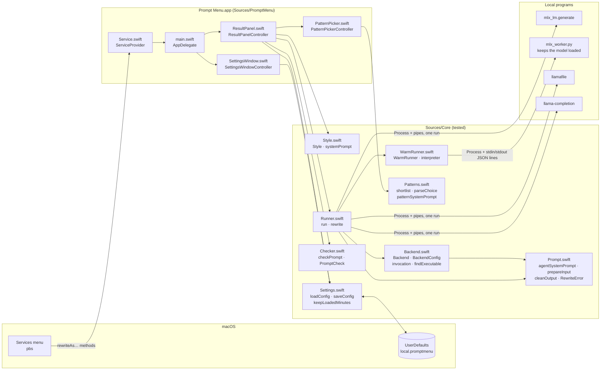
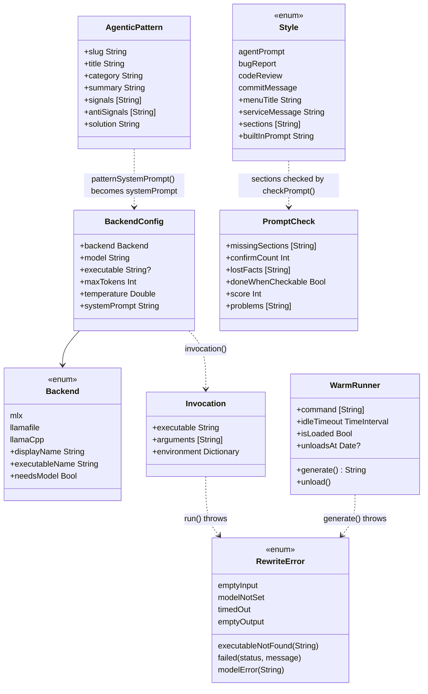

# Architecture

Prompt Menu is one small macOS app with no dependencies. It has two layers:

- **`Sources/Core`**: everything that can be tested without a screen. It covers the styles and their instructions, the command line for each runner, running a program, keeping an MLX model loaded, the prompt checker, the agentic patterns and settings. It uses only Foundation.
- **`Sources/PromptMenu`**: the AppKit shell. It covers the Services entry points, the result dialog with its versions and pattern picker, the settings window, the menu-bar item and the app lifecycle.
- **`Resources`**: the Info.plist, the MLX worker script (`mlx_worker.py`), and the pattern catalog snapshot (`patterns.json`) with its license notice.

The tests compile `Tests/` together with `Sources/Core` only. Anything in `Sources/PromptMenu` is checked by building the app and running it by hand (see [DEVELOPMENT.md](DEVELOPMENT.md)).

## Files

| File | Owns | Depends on |
|---|---|---|
| `Sources/Core/Style.swift` | The styles (`Style`: agent prompt, bug report, code review request, commit message), each with its Services title and method, instructions and section names; `systemPrompt(for:config:)`; the Replace Selection method name and timeout. | Prompt, Backend |
| `Sources/Core/Prompt.swift` | The built-in agent prompt instructions (`agentSystemPrompt`), input limits (`maxInputCharacters`, `prepareInput`), `combinedPrompt`, output cleanup (`cleanOutput`), and errors and their messages (`RewriteError`). | Foundation |
| `Sources/Core/Backend.swift` | The runners (`Backend`), a run's settings (`BackendConfig`), the exact command line per runner (`invocation`), and finding programs (`findExecutable`, `standardSearchDirs`). | Prompt |
| `Sources/Core/Runner.swift` | Running a program with a timeout, streaming its stdout and reporting failures (`run`), plus the whole pipeline from text in to prompt out (`rewrite`), which uses the kept-loaded worker when it's given one and falls back to a one-time run. | Prompt, Backend, WarmRunner |
| `Sources/Core/WarmRunner.swift` | `WarmRunner`: the MLX worker process, its JSON-lines protocol, one request at a time, cancel, timeout, and unloading after `idleTimeout`. `interpreter(ofScript:)` finds the Python that has mlx-lm. | Prompt |
| `Sources/Core/Checker.swift` | `checkPrompt` and `PromptCheck`: missing sections, dropped facts, open `[CONFIRM: …]` questions, a checkable DONE WHEN, and a score with fixed point costs. No model. | Style |
| `Sources/Core/Patterns.swift` | `AgenticPattern`, loading the catalog, `rankPatterns` and `shortlist` (keyword fit), `searchPatterns`, the model's typed choice (`patternChoicePrompt`, `parseChoice`), and `patternSystemPrompt`. | Style |
| `Sources/Core/Settings.swift` | Reading and writing preferences (`loadConfig`, `saveConfig`, `keepLoadedMinutes`), the default model, and the allowed ranges. | Backend |
| `Sources/PromptMenu/Service.swift` | `ServiceProvider`, the object macOS calls for the five Services items. | Core |
| `Sources/PromptMenu/ResultPanel.swift` | One dialog per request: spinner and timer, streamed text, versions, the check badge, the Agentic Pattern button, Copy, Try Again and Close, and stopping the model when closed. | Core |
| `Sources/PromptMenu/PatternPicker.swift` | The pattern popover: the shortlist, search over the whole catalog, the model's ★ pick, Use when / Avoid when, Apply. | Core |
| `Sources/PromptMenu/SettingsWindow.swift` | The settings window, which checks the runner live, the keep-loaded time, and Try It. | Core |
| `Sources/PromptMenu/main.swift` | `AppDelegate`: wiring, the main menu, Replace Selection and its progress window, the kept-loaded worker and its menu-bar item, when to show settings, and when to quit. | everything |
| `Resources/App-Info.plist` | The bundle id, version, `LSUIElement`, and the **`NSServices`** entries that create the menu items. | — |
| `Resources/mlx_worker.py` | The worker that keeps an MLX model loaded. Talks over stdin and stdout only, forces offline mode, exits when stdin closes. | mlx-lm |
| `Resources/patterns.json` · `NOTICE-agentic-patterns.txt` | A snapshot of [Awesome Agentic Patterns](https://github.com/nibzard/awesome-agentic-patterns) (Apache-2.0) and its license. Generated by `scripts/update-patterns.sh`; never edited by hand. | — |
| `scripts/build.sh` · `test.sh` · `install.sh` · `update-patterns.sh` | Compiling with `swiftc` and copying the resources, running the tests, installing and registering the app, and refreshing the pattern snapshot (development only). | — |

## Key types

## How each runner is called

These command lines are the contract with each runner, and `Tests/BackendTests.swift` asserts them argument by argument.

| Backend | Program | Arguments | Environment |
|---|---|---|---|
| `mlx` | `mlx_lm.generate` | `--model M --system-prompt S --prompt TEXT --max-tokens N --temp T --verbose True` | `HF_HUB_OFFLINE=1 TRANSFORMERS_OFFLINE=1 PYTHONUNBUFFERED=1` |
| `llamafile` | `/bin/sh` + `llamafile` path | `[-m M] --cli -p "S\n\nText to rewrite:\nTEXT" -n N --temp T` | — |
| `llama.cpp` | `llama-completion` | `-m M -sys S -p TEXT -cnv -st --no-display-prompt --log-disable -n N --temp T` | — |

Why they differ:

- **MLX uses `--verbose True`** so tokens print as they're made. The text arrives between two `==========` lines and is followed by stats, and `cleanOutput` removes all of that. `PYTHONUNBUFFERED=1` stops Python from holding output back when stdout is a pipe. `HF_HUB_OFFLINE=1` guarantees no download.
- **llamafile runs under `/bin/sh`.** llamafiles are Actually Portable Executables, which start with a shell-script header that `posix_spawn` rejects. `--cli` is llamafile 0.10's one-shot mode. Its system-prompt support isn't documented, so the instructions are put in front of the text (`combinedPrompt`).
- **llama.cpp uses `llama-completion`**, the one-shot program. Newer `llama-cli` builds are interactive-only. `-cnv -st` applies the model's chat template for a single turn, and `-sys` sets the system prompt.

## Keeping an MLX model loaded

With MLX and a keep-loaded time above 0 (default 5 minutes), `rewrite` sends the request to a `WarmRunner` instead of starting `mlx_lm.generate`. The worker is `Resources/mlx_worker.py`, started with the Python from `mlx_lm.generate`'s `#!` line (`interpreter(ofScript:)`), so it uses the same mlx-lm install. It talks over its stdin and stdout, one JSON object per line:

| Direction | Message |
|---|---|
| app → worker | `{"id", "model", "system", "prompt", "max_tokens", "temp"}` |
| app → worker | `{"cancel": id}` |
| worker → app | `{"id", "text": "more text"}`, repeated while it generates |
| worker → app | `{"id", "done": true}` or `{"id", "error": "message"}` |

- One request at a time. The worker loads the model on the first request and again only when the model changes.
- A cancel stops generation at the next token; the request ends with `done` and the text so far.
- The worker exits when its stdin closes. That happens on unload, when the app quits, and when the app dies, so it can't outlive the app.
- After `idleTimeout` without a request, `WarmRunner` unloads it. The app shows a menu-bar item only while a model is loaded (Unload Model Now, the time left), and quits once nothing is open and nothing is loaded.
- If the worker can't start or dies before replying (`WarmRunnerUnavailable`), `rewrite` runs `mlx_lm.generate` once instead and reports why through `notice`. An `error` reply is a real failure (`RewriteError.modelError`), such as a model that isn't downloaded.
- Measured on an 8 GB M-series Mac with Llama 3.2 3B 4-bit: first text after 9.9 s cold and 0.7 s warm; Replace Selection took 14.5 s cold and 5.9 s warm.

`WarmRunner` ignores SIGPIPE for the whole app: writing to a worker that just died must report an error, not kill the app.

## Agentic patterns

The **Agentic Pattern…** button restructures the current text around one workflow from Awesome Agentic Patterns.

1. **Shortlist, without a model.** `rankPatterns` scores each pattern by the words it shares with the prompt, weighted by field (title and tags 3, signals 2, summary 1.5), rarer words counting more (IDF), minus words in its "Avoid when". `shortlist` keeps up to three patterns that share at least three words, and fills the rest from `generalPatternSlugs` (plan-then-execute, spec-as-test, self-critique, output verification, phase separation). Fewer than three shared words is usually a coincidence.
2. **The model's pick, only when it's already loaded.** `patternChoicePrompt` lists the options as letters with Use when / Avoid when, and the model answers with one letter (`parseChoice`), like a decision model making a typed choice. It's marked ★ in the picker. If no model is loaded, the keyword order stands rather than making the user wait for a load. A 3B model's pick is a hint, not a verdict.
3. **The rewrite.** `patternSystemPrompt(pattern, sections:)` gives the pattern as background (code blocks, headings and emphasis removed so the model can't copy them) and lists the exact headings to produce: the style's sections plus `WORKFLOW PATTERN: <title>, because …` after OBJECTIVE. With the first wording, a 3B model copied the pattern's headings and dropped four sections (check score 40). With exact headings, four patterns all kept the structure (score 100).
4. **A new version.** The result is added to the dialog's versions; the first draft and any edits stay available.

The catalog is a snapshot (`Resources/patterns.json`, 203 patterns) made by `scripts/update-patterns.sh` from the repository at a recorded commit. The app never downloads it. Only titles, metadata and a 1,200-character excerpt of each Solution section are included, with the Apache-2.0 license in `NOTICE-agentic-patterns.txt`.

## The prompt checker

`checkPrompt(prompt, source:, style:)` runs on every edit, so it's deterministic and cheap. It finds:

| Problem | Cost |
|---|---|
| A section of the style missing (headings like `ROLE:`, `**ROLE:**`, `## Role:` all count) | 15 each |
| A fact from the highlighted text that's gone: a number, a file or path, quoted text, a camelCase or snake_case name, a link | 5 each, at most 25 |
| An open `[CONFIRM: …]` question | 4 each, at most 20 |
| DONE WHEN with nothing checkable (no number, and none of words such as pass, returns, shows, builds) | 10 |
| A commit subject over 72 characters | 15 |

The score is 100 minus the costs, at least 0. It measures "can I hand this to an agent as is", not writing quality.

## Design decisions

| Decision | Why | Rejected alternative |
|---|---|---|
| Runners are separate programs, started fresh for each rewrite | No network code at all, no server to manage, and nothing left in memory after the dialog closes. | A local HTTP server (Ollama, `mlx_lm.server`, `llamafile --server`). It's faster on repeat runs, but it's network code and a long-running process. |
| The MLX model is kept loaded by a child process over stdin and stdout | Back-to-back rewrites skip the model load (first text 0.7 s instead of 9.9 s) without any socket: only this app can talk to the worker, and it exits with the app. Unloaded after 5 minutes by default; 0 turns it off. | `mlx_lm.server`, which is an HTTP server. `mlx_lm.chat` over stdin, which keeps a conversation history and has no cancel. |
| Five Services items, one for in-place replacement | Each style is one click from the right-click menu. Replace Selection is for when no dialog is wanted. | A style chooser in the dialog (an extra step), or an in-place twin for every style (ten items in every app's menu). |
| A deterministic checker, no model | Instant, reproducible, runs on every keystroke, and catches what small models get wrong (dropped facts and sections). | Asking the model to grade itself: slow and biased toward its own output. |
| The pattern catalog is a snapshot in the app | No network, no stale cache, and a pinned commit. | Fetching the repository at run time. |
| Keyword shortlist, then the model's typed choice | The keyword pass is instant and explainable; the model only chooses among five, which a small model can do in a second. | Asking a small model to pick from 203 patterns, which overflows its context and attention. |
| A Services menu item, not a Finder extension | Services is macOS's built-in way to act on highlighted text in any app. A Finder Sync extension only sees files. | Finder extension, accessibility APIs reading the selection (they need a permission prompt), or a global hotkey that copies the selection. |
| No in-process MLX (mlx-swift) | Its Metal shaders only build with full Xcode, and this project builds with the Command Line Tools. | mlx-swift through SwiftPM. It's the best next step for users who have Xcode. |
| A plain `swiftc` build and a home-made test runner | No Xcode project to maintain, and XCTest isn't part of the Command Line Tools. Same approach as Finder Menu. | SwiftPM or an Xcode project. |
| The app quits when idle | Python and the model's memory are released, and there's nothing to keep updated. | Staying resident as a menu-bar app. |
| The built-in prompt is saved as `""` | A better prompt in a later version reaches everyone who didn't customize theirs. | Saving the full text. |
| `cleanOutput` is safe to run on partial text | It's called on every streamed chunk, so it never shows half of something it would remove later (such as an unclosed `<think>`). | Cleaning only at the end, which would flash runner noise while streaming. |

## Invariants

These are enforced by tests in `Tests/GuardrailTests.swift` and `Tests/ServiceTests.swift`:

1. **No network code** in `Sources/` (`testNoNetworkCode`).
2. **No entitlements and no `*UsageDescription` keys** (`testNoEntitlementsOrPermissions`).
3. **The Services wiring matches**: every `NSMessage` in the plist is a `Style.serviceMessage` or `inPlaceServiceMessage`, each has a method with the Services signature in `Service.swift`, each style has its item with its `menuTitle`, and the in-place item returns text with an `NSTimeout` longer than `inPlaceTimeout` (`testServicesEntry`).
4. **The docs list every runner**: README.md and this file mention every `Backend.executableName` (`testDocsCoverEveryRunner`).
5. **Command lines are pinned**: every argument for each backend is asserted (`BackendTests`).
6. **The worker stays offline and local**: `Resources/*.py` contain no networking or download calls and force `HF_HUB_OFFLINE` (`testNoNetworkCode`).
7. **The worker protocol is pinned** by a fake worker that speaks it (`WarmRunnerTests`).
8. **The pattern catalog is complete and licensed**: every pattern has its fields, and the NOTICE carries the Apache license (`testPatternsCatalog`).

## Threading

- `ResultPanelController.run(_:)` runs `rewrite` on a background queue (`.userInitiated`).
- `run` reads stdout and stderr through `readabilityHandler` on system queues, guarded by an `NSLock`. Progress callbacks arrive on those queues, and the panel hops to the main queue to update.
- `WarmRunner` serializes requests with one lock and guards its state with another. Its stdout handler parses lines and calls `progress` before it signals the waiting `generate`, so the last update arrives before the result.
- Each run has a `generation` number. Results and progress from an older run (after Try Again, or after the dialog closed) are ignored.
- `rewrite`'s `started` callback hands the panel a function that stops the model: `terminate()` for a one-time run, a cancel message for the worker. Closing the dialog or pressing Try Again calls it. If the dialog closed before the callback arrived, the callback stops the model itself.
- Quitting the app (⌘Q, logout, or SIGTERM, which `main.swift` turns into a normal quit) stops every panel's model and unloads the worker in `applicationWillTerminate`, so none is orphaned. `Process` starts each runner in its own process group and `terminate()` stops the whole group, so a llamafile running as `/bin/sh`'s child is stopped too.
- Replace Selection blocks the Services call (the app that asked waits for the text) but keeps the main run loop turning, so its progress window stays live.
- `Process` starts each runner in its own process group, and `terminate()` stops that whole group. This also stops a llamafile, which runs as a child of `/bin/sh` (`testRunTimeout`).
