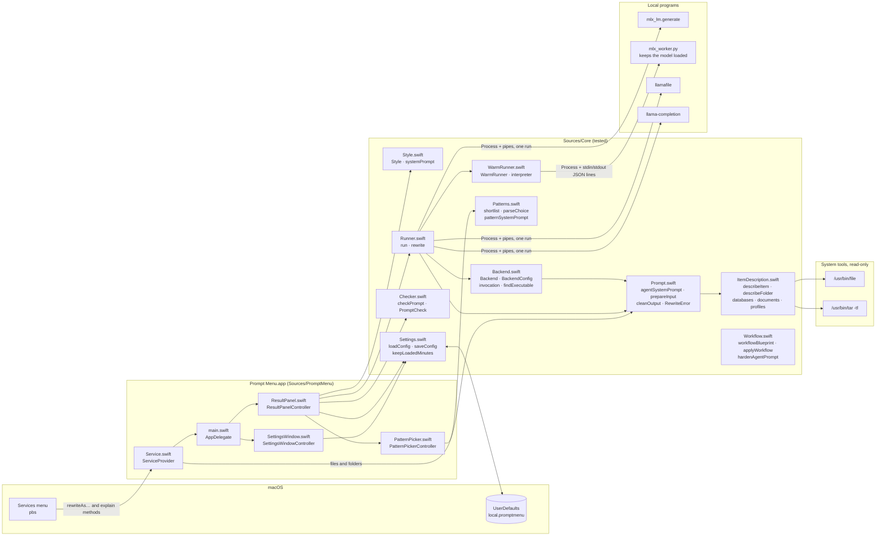
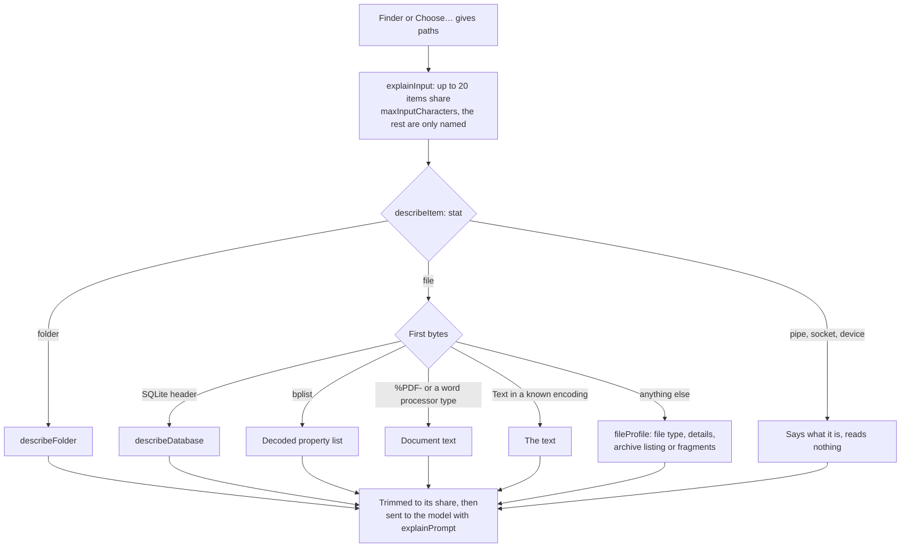
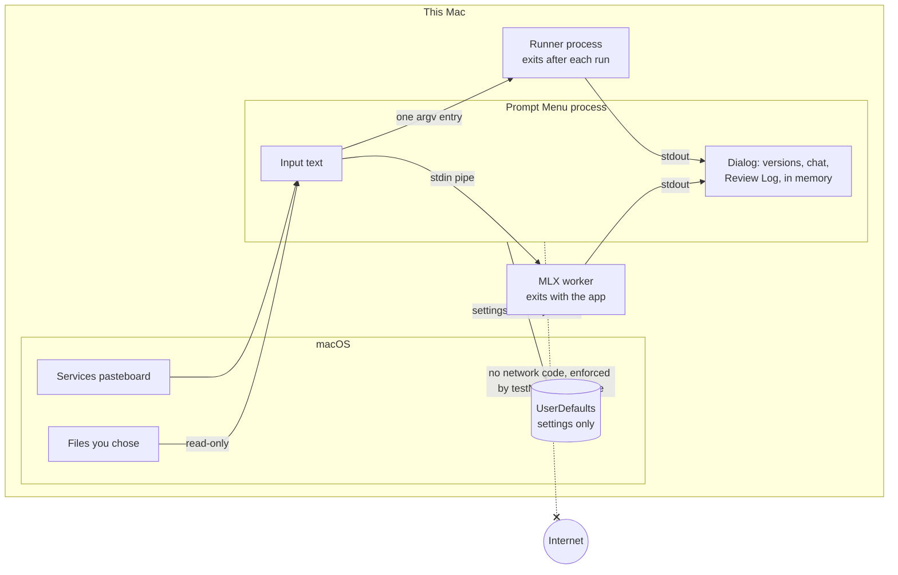
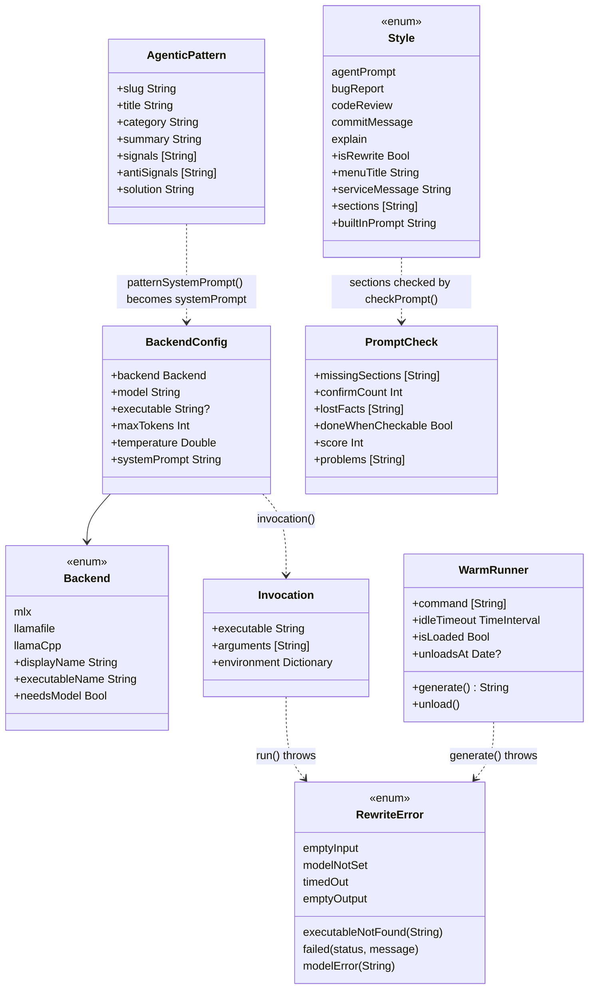

# Architecture

Prompt Menu is one small macOS app with no third-party dependencies. It adds six items to the macOS Services menu. Five rewrite highlighted text, and **Explain This for Me** explains highlighted text or anything chosen in Finder. All the work is done by a local model program that the app starts and stops, so the app holds no network code, no server and no stored user data. It starts when macOS calls it and quits when nothing is left open.

It has two layers:

- **`Sources/Core`**: everything that can be tested without a screen. It covers the styles and their instructions, the command line for each runner, running a program, keeping an MLX model loaded, the prompt checker, the agentic patterns, settings and inspecting items from Finder. It uses Foundation, plus AppKit, PDFKit and SQLite3 in `ItemDescription.swift`, all of which ship with macOS.
- **`Sources/PromptMenu`**: the AppKit shell. It covers the Services entry points, the result dialog with its versions and pattern picker, the settings window, the menu-bar item and the app lifecycle.
- **`Resources`**: the Info.plist, the MLX worker script (`mlx_worker.py`), and the pattern catalog snapshot (`patterns.json`) with its license notice.

The tests compile `Tests/` together with `Sources/Core` only. Anything in `Sources/PromptMenu` is checked by building the app and running it by hand (see [DEVELOPMENT.md](DEVELOPMENT.md)).

## Files

| File | Owns | Depends on |
|---|---|---|
| `Sources/Core/Style.swift` | The styles (`Style`: agent prompt, bug report, code review request, commit message, explain), each with its Services title and method, instructions and section names; `isRewrite` (false for explain, which hides the rewrite tools) and `maxTokens(base:)`; `systemPrompt(for:config:)`; the Replace Selection method name and timeout. | Prompt, Backend |
| `Sources/Core/ItemDescription.swift` | What Explain sends for anything chosen in Finder (`describeItem`, `describeFolder`): decides by contents, read-only, and limited in time and size. See [How Explain reads anything](#how-explain-reads-anything). | Prompt, AppKit, PDFKit, SQLite3, `/usr/bin/file`, `/usr/bin/tar` |
| `Sources/Core/Prompt.swift` | The built-in agent prompt instructions (`agentSystemPrompt`), input limits (`maxInputCharacters`, `prepareInput`), `combinedPrompt` (with the input's label), Finder files for Explain (`explainInput(files:)`), output cleanup (`cleanOutput`), and errors and their messages (`RewriteError`). | Foundation |
| `Sources/Core/Backend.swift` | The runners (`Backend`), a run's settings (`BackendConfig`, including `inputLabel` for llamafile's combined prompt: "Text to rewrite", "Text to explain" or "Question"), the exact command line per runner (`invocation`), and finding programs (`findExecutable`, `standardSearchDirs`). | Prompt |
| `Sources/Core/Runner.swift` | Running a program with a timeout, streaming its stdout and reporting failures (`run`), plus the whole pipeline from text in to prompt out (`rewrite`), which uses the kept-loaded worker when it's given one and falls back to a one-time run. | Prompt, Backend, WarmRunner |
| `Sources/Core/WarmRunner.swift` | `WarmRunner`: the MLX worker process, its JSON-lines protocol, one request at a time, cancel, timeout, and unloading after `idleTimeout`. `interpreter(ofScript:)` finds the Python that has mlx-lm. | Prompt |
| `Sources/Core/Checker.swift` | `checkPrompt` and `PromptCheck`: missing sections, dropped facts, open `[CONFIRM: …]` questions, a checkable DONE WHEN, and a score with fixed point costs. No model. | Style |
| `Sources/Core/Patterns.swift` | `AgenticPattern`, loading the catalog, `rankPatterns` and `shortlist` (task type, then keyword fit), `searchPatterns`, the model's typed choice (`patternChoicePrompt`, `parseChoice`), the whole-catalog pick for ~7B models (`pickPattern`), and `patternSystemPrompt`. | Style |
| `Sources/Core/Workflow.swift` | What makes a rewrite a workflow: `workflowBlueprint(for:)` (phases and gates), `agentSections`, `hardenAgentPrompt` (with the user's stated limits added and made-up ones dropped), `applyWorkflow` (phase details that contradict their gate or are code are dropped), `phaseDetailsSystemPrompt` (one line per phase, nothing else), `finishedPrompt`, `removingStandardLines`. |
| `Sources/Core/Finishing.swift` | Code repairs for what a 3B model gets wrong every time: `questioningInventedNames` (files, folders and numbers the text never gave get a `[CONFIRM: …]`), `finishedCommitMessage` (labels, subject, CONFIRM brackets, the `Verified:` line), `finishedExplanation` (bullets run together on one line). Measured cases in docs/DECISIONS.md. | Checker |
| `Sources/Core/Harness.swift` | Send To: `Harness` (a CLI as data), `defaultHarnesses`, `loadHarnesses` (`harnesses.json`, read only), `installedHarnesses`, `terminalScript` (folder and command only; the prompt comes from the clipboard), `copyCommand`, recent folders. | Backend, Settings |
| `Sources/Core/Models.swift` | Finding models already on this Mac (`LocalModel`, `localModels`, `modelSearchFolders`), `missingModel` for a deleted model, `BackendConfig.choosing`, and the Compare estimate and memory fit. Reads the file system only. | Backend, Settings |
| `Sources/Core/Fill.swift` | Fill Gaps: `confirmQuestions`, `fill` (exact replacement, no model) and the Polish instructions. | — |
| `Sources/Core/Project.swift` | Add Project: `projectContext(folder:)` keeps the headings and commands of a chosen folder's AGENTS.md, CLAUDE.md and README; `withProjectContext`. | — |
| `Sources/Core/Review.swift` | The Review pipeline: the blind jury (`juryPrompt`, `parseVote`, `shuffledOrder`, `agreedVote`, `judgeWeight`, `juryWinner`), hardening (`HardenRole`, `parseHardenReply`, `removeEchoedLines`, `removePreamble`, `hardenVerdict`), the state machine (`ReviewMachine`), `ReviewPipeline`, the log with `lineDiff`, and the estimate. Model calls are injected, so all of it is tested without a model. | Checker, Patterns, Models |
| `Sources/Core/Chat.swift` | The follow-up chat: `ChatTurn`, `chatSystemPrompt(style:)` (answer every question), `chatContext`, which fits the context into `maxChatCharacters` with fixed shares (the newest turns up to 3,000 characters, oldest dropped first; the start of the result up to 3,000; the highlighted text in the rest, up to `maxInputCharacters`), so a long text never pushes the conversation out; `isNonAnswer` (only clear cases: an apology or "can't answer" or "has no information" in the first sentence, a context heading alone on its line, or the result returned unchanged); and `answerFollowUp`, which asks once with the context and, on a non-answer or an earlier answer of 40+ characters repeated for a new question, once without it, unless stopped in between. Follow-ups are labelled "Question" for llamafile. | Style |
| `Sources/Core/Settings.swift` | Reading and writing preferences (`loadConfig`, `saveConfig`, `keepLoadedMinutes`), the default model, and the allowed ranges. | Backend |
| `Sources/PromptMenu/Service.swift` | `ServiceProvider`, the object macOS calls for the six Services items. Explain This for Me also takes file and folder URLs from Finder. | Core |
| `Sources/PromptMenu/FailurePanel.swift` | The window that says why a Services request failed, with **Choose…** for a file or folder macOS blocked. Not a modal alert, which would hold up other requests and quitting. |
| `Sources/PromptMenu/ResultPanel.swift` | One dialog per request: spinner and timer, streamed text, versions, the check badge, the model menu (with Compare Models, Review and Review Log), Fill Gaps, Add Project, the Agentic Pattern button, the follow-up chat (`askQuestion`), Copy, Try Again and Close, and stopping the model when closed. | Core |
| `Sources/PromptMenu/ModelMenu.swift` | The model menu items (`modelMenuItems`, `ActionMenuItem`) and `modelsOnThisMac`. | Core |
| `Sources/PromptMenu/ModelsSheet.swift` | The sheet for ticking models, with an estimate, used by Compare Models and Review. | Core |
| `Sources/PromptMenu/FillGapsSheet.swift` | One field per `[CONFIRM: …]` question, and the Polish checkbox. | Core |
| `Sources/PromptMenu/ReviewLogSheet.swift` | The read-only Review Log. | — |
| `Sources/PromptMenu/PatternPicker.swift` | The pattern popover: the shortlist, search over the whole catalog, the model's ★ pick, Use when / Avoid when, Apply. | Core |
| `Sources/PromptMenu/SettingsWindow.swift` | The settings window, which checks the runner live, the keep-loaded time, and Try It. | Core |
| `Sources/PromptMenu/main.swift` | `AppDelegate`: wiring, the main menu, Replace Selection and its progress window, the kept-loaded worker and its menu-bar item, when to show settings, and when to quit. | everything |
| `Resources/App-Info.plist` | The bundle id, version, `LSUIElement`, and the **`NSServices`** entries that create the menu items. | — |
| `Resources/mlx_worker.py` | The worker that keeps an MLX model loaded. Talks over stdin and stdout only, forces offline mode, exits when stdin closes. | mlx-lm |
| `Resources/patterns.json` · `NOTICE-agentic-patterns.txt` | A snapshot of [Awesome Agentic Patterns](https://github.com/nibzard/awesome-agentic-patterns) (Apache-2.0) and its license. Generated by `scripts/update-patterns.sh`; never edited by hand. | — |
| `scripts/build.sh` · `test.sh` · `install.sh` · `update-patterns.sh` | Compiling with `swiftc` and copying the resources, running the tests, installing and registering the app, and refreshing the pattern snapshot (development only). | — |

## How Explain reads anything

A small text model can't use raw bytes, but it's good at explaining structure and names. So `explainInput(files:)` hands each chosen item to `describeItem`, which decides what the item is from its contents and turns it into text. The extension only matters for picking a word processor format.

If a database can't be opened, or a document has no text, the item falls through to the next reader and ends at `fileProfile`, so a wrong guess never becomes a refusal. The only errors left are `protectedFile` (macOS refused, so **Choose…** is offered), `unreadableFile` (gone or unavailable) and `emptyFile`. In a selection of several items, only `protectedFile` stops the request, because **Choose…** can grant the whole selection. Other failures become a note, unless every item failed.

### Limits

These run on the main thread while Finder waits, so each part has a limit.

| What | Limit | When it's reached |
|---|---|---|
| Everything sent to the model | 8,000 characters (`maxInputCharacters`) | Cut; several items each get a share |
| Items described in one request | 20 | The rest are named only |
| Folder walk | 2 s, 20,000 entries | Stops, and the summary says "Stopped early" |
| Folder layout | 30 entries per folder, 5 levels at most | "… and N more"; levels drop until it fits |
| Files sampled from a folder | 4 read, from 16 candidates, at most two levels down and 1 MB each, about 40% of the space | Others are listed only |
| Database | 3 s total, 0.3 s per count or table query | The query stops, and the count shows as "rows not counted" |
| Database samples | 3 rows per table, 80 characters per value | Blobs show as "N-byte blob" |
| `file` and `tar` | 3 s, and a byte limit | The process is stopped; what it printed is used |
| Binary property list, Word formats | 8 MB, 32 MB | Falls through to `fileProfile` |

PDF text extraction stops once it has enough text, but PDFKit's own opening of a file has no time limit, and neither does a read from a slow disk.

### Privacy decisions in the code

- **Databases open with `immutable=1` and `SQLITE_OPEN_READONLY`:** no locks, and no journal or `-wal` files. Changes still in another app's write-ahead log aren't seen. `PRAGMA trusted_schema=OFF` limits what a file's schema can call, and a progress handler enforces the time limits.
- **Word formats name their `DocumentType` explicitly,** and HTML is treated as plain text, so a file can't reach AppKit's HTML importer, which could load remote resources.
- **Files sampled from a folder skip `secretNamePattern`, and any content with a private key marker.** Secret-looking columns show as `(hidden)`. Both are best effort, and they don't apply to a file chosen directly, which the user asked for.
- **The walk uses `lstat`, so links aren't followed,** and it skips reading `SF_DATALESS` (online-only) files, which would otherwise make macOS download them.
- **`file` and `tar` get the path as one `Process` argument,** with no shell, per the rule on user text. `tar -tf` only lists.

## Where data goes

Text passed in `argv` can be seen by other processes under the same account while a one-shot runner is alive, for example through `ps`. The kept-loaded worker uses a pipe instead. The app's no-network guarantee doesn't extend to a runner the user installed, though MLX and the worker are forced offline with `HF_HUB_OFFLINE=1`. The app has no sandbox: entitlements are ruled out, so reading only what was chosen is the code's behavior, not an OS limit.

## Key types

## How each runner is called

These command lines are the contract with each runner, and `Tests/BackendTests.swift` asserts them argument by argument.

| Backend | Program | Arguments | Environment |
|---|---|---|---|
| `mlx` | `mlx_lm.generate` | `--model M --system-prompt S --prompt TEXT --max-tokens N --temp T --verbose True` | `HF_HUB_OFFLINE=1 TRANSFORMERS_OFFLINE=1 PYTHONUNBUFFERED=1` |
| `llamafile` | `/bin/sh` + `llamafile` path | `[-m M] --cli -p "S\n\nText to rewrite:\nTEXT" -n N --temp T` | — |
| `llama.cpp` | `llama-completion` | `-m M -sys S -p TEXT -cnv -st --no-display-prompt -n N --temp T` | — |

Why they differ:

- **MLX uses `--verbose True`** so tokens print as they're made. The text arrives between two `==========` lines and is followed by stats, and `cleanOutput` removes all of that. `PYTHONUNBUFFERED=1` stops Python from holding output back when stdout is a pipe. `HF_HUB_OFFLINE=1` guarantees no download.
- **llamafile runs under `/bin/sh`.** llamafiles are Actually Portable Executables, which start with a shell-script header that `posix_spawn` rejects. `--cli` is llamafile 0.10's one-shot mode. Its system-prompt support isn't documented, so the instructions are put in front of the text (`combinedPrompt`).
- **llama.cpp uses `llama-completion`**, the one-shot program. Newer `llama-cli` builds are interactive-only. `-cnv -st` applies the model's chat template for a single turn, and `-sys` sets the system prompt.

## Keeping an MLX model loaded

With MLX and a keep-loaded time above 0 (default 5 minutes), `rewrite` sends the request to a `WarmRunner` instead of starting `mlx_lm.generate`. The worker is `Resources/mlx_worker.py`, started with the Python from `mlx_lm.generate`'s `#!` line (`interpreter(ofScript:)`), so it uses the same mlx-lm install. It talks over its stdin and stdout, one JSON object per line:

| Direction | Message |
|---|---|
| app → worker | `{"id", "model", "system", "prompt", "max_tokens", "temp"}` |
| app → worker | `{"cancel": id}` |
| worker → app | `{"id", "text": "more text"}`, repeated while it generates |
| worker → app | `{"id", "done": true}` or `{"id", "error": "message"}` |

- One request at a time. The worker loads the model on the first request and again only when the model changes.
- A cancel stops generation at the next token; the request ends with `done` and the text so far.
- The worker exits when its stdin closes. That happens on unload, when the app quits, and when the app dies, so it can't outlive the app.
- After `idleTimeout` without a request, `WarmRunner` unloads it. The app shows a menu-bar item only while a model is loaded (Unload Model Now, the time left), and quits once nothing is open and nothing is loaded.
- If the worker can't start or dies before replying (`WarmRunnerUnavailable`), `rewrite` runs `mlx_lm.generate` once instead and reports why through `notice`. An `error` reply is a real failure (`RewriteError.modelError`), such as a model that isn't downloaded.
- Measured on an 8 GB M-series Mac with Llama 3.2 3B 4-bit: first text after 9.9 s cold and 0.7 s warm; Replace Selection took 14.5 s cold and 5.9 s warm.

`WarmRunner` ignores SIGPIPE for the whole app: writing to a worker that just died must report an error, not kill the app.

## Agentic patterns

The **Agentic Pattern…** button restructures the current text around one workflow from Awesome Agentic Patterns.

1. **Shortlist, without a model.** Workflows for the kind of task come first (`taskTypeWorkflows`, judged on OBJECTIVE and CONTEXT, since any draft's steps mention errors and fixes). Then `rankPatterns` scores each pattern by the words it shares with the prompt, weighted by field (title and tags 3, signals 2, summary 1.5), rarer words counting more (IDF), minus words in its "Avoid when". `shortlist` keeps up to three patterns that share at least three words, and fills the rest from `generalPatternSlugs` (plan-then-execute, spec-as-test, self-critique, output verification, phase separation). Fewer than three shared words is usually a coincidence.
2. **The model's pick, only when it's already loaded.** `patternChoicePrompt` lists the options as letters with Use when / Avoid when, and the model answers with one letter (`parseChoice`), like a decision model making a typed choice. It's marked ★ in the picker. If no model is loaded, the keyword order stands rather than making the user wait for a load. A 3B model's pick is a hint, not a verdict.
3. **The rewrite.** A 3B model asked to restructure a prompt copies its old list and adds the pattern's name, so for an agent prompt code owns the structure (`Workflow.swift`). `workflowBlueprint(for:)` gives the phases and their gates: written by hand for the eight patterns the shortlist offers most, and by catalog category for the rest. `phaseDetailsSystemPrompt(pattern)` asks the model for one line per phase and nothing else (asked for the whole prompt, Qwen 2.5 3B copied the old list 3 runs out of 3); other styles still get `patternSystemPrompt(pattern, sections:)`, with the pattern as background (code blocks, headings and emphasis removed). `applyWorkflow` takes only each phase's task details from the reply, dropping echoes of the instructions, sentences copied from the catalog, code, and details that contradict the phase's gate, and keeps ROLE, OBJECTIVE, CONTEXT, CONSTRAINTS and DONE WHEN from the prompt, so the model can't lose a fact. If it added details to no phase, the workflow still stands and the draft's steps follow it as a checklist. Other styles have no STEPS, and keep the old rewrite.
4. **A new version.** The result is added to the dialog's versions; the first draft and any edits stay available.

The catalog is a snapshot (`Resources/patterns.json`, 203 patterns) made by `scripts/update-patterns.sh` from the repository at a recorded commit. The app never downloads it. Only titles, metadata and a 1,200-character excerpt of each Solution section are included, with the Apache-2.0 license in `NOTICE-agentic-patterns.txt`.

A first draft goes through `hardenAgentPrompt` (via `finishedPrompt`, also used by Replace Selection): the model's steps stay, and code adds any missing section, the work loop, `agentConstraints`, the original request (up to 600 characters, marked as taking priority) and any dropped fact. It's idempotent, and it leaves alone text with no sections (a refusal) and a custom `systemPrompt`.

## The prompt checker

`checkPrompt(prompt, source:, style:)` runs on every edit, so it's deterministic and cheap. It finds:

| Problem | Cost |
|---|---|
| A section of the style missing (headings like `ROLE:`, `**ROLE:**`, `## Role:` all count) | 15 each |
| A fact from the highlighted text that's gone: a number, a file or path, quoted text, a camelCase or snake_case name, a link | 5 each, at most 25 |
| An open `[CONFIRM: …]` question | 4 each, at most 20 |
| DONE WHEN with nothing checkable (no number, and none of words such as pass, returns, shows, builds) | 10 |
| A commit subject over 72 characters | 15 |
| Agent prompts: no check of each step, no way to recover from a failure, or no point to stop and report | 5 each |
| Agent prompts: `WORKFLOW PATTERN:` with fewer than two gates in STEPS, which names a pattern without applying it | 15 |

The score is 100 minus the costs, at least 0. It measures "can I hand this to an agent as is", not writing quality.

## Design decisions

| Decision | Why | Rejected alternative |
|---|---|---|
| Runners are separate programs, started fresh for each rewrite | No network code at all, no server to manage, and nothing left in memory after the dialog closes. | A local HTTP server (Ollama, `mlx_lm.server`, `llamafile --server`). It's faster on repeat runs, but it's network code and a long-running process. |
| The MLX model is kept loaded by a child process over stdin and stdout | Back-to-back rewrites skip the model load (first text 0.7 s instead of 9.9 s) without any socket: only this app can talk to the worker, and it exits with the app. Unloaded after 5 minutes by default; 0 turns it off. | `mlx_lm.server`, which is an HTTP server. `mlx_lm.chat` over stdin, which keeps a conversation history and has no cancel. |
| Six Services items: five rewrites (one in place) and Explain This for Me | Each style is one click from the right-click menu. Replace Selection is for when no dialog is wanted. | A style chooser in the dialog (an extra step), or an in-place twin for every style (ten items in every app's menu). |
| The follow-up chat sends the whole conversation each time | The runners answer one prompt and exit, so there's no session to keep. The kept-loaded MLX model makes follow-ups fast anyway. The context goes in the system prompt and the question alone is the prompt: sent as one message, Qwen 2.5 3B repeated the context back. A non-answer is asked again without the context, so off-topic questions still get answered. | A chat mode in the worker (MLX only, and state that outlives the dialog). Prompt wording alone, which a 3B model followed only some of the time. |
| Explain is offered on everything, and describes what it can't quote | Refusing a folder or binary after the click is useless, and a type list can't match a file with no extension. A small model explains structure and names well. See [DECISIONS.md](DECISIONS.md). | Text types only, which was the earlier choice. |
| An item's kind comes from its contents | A `.db` may not be SQLite, and SQLite may have no extension. | Trusting the extension. |
| The system SQLite library, opened immutable | It can guarantee read-only access and enforce a time limit, in-process, and it ships with macOS. | Running `sqlite3`, or a bundled copy. |
| A deterministic checker, no model | Instant, reproducible, runs on every keystroke, and catches what small models get wrong (dropped facts and sections). | Asking the model to grade itself: slow and biased toward its own output. |
| The pattern catalog is a snapshot in the app | No network, no stale cache, and a pinned commit. | Fetching the repository at run time. |
| Keyword shortlist, then the model's typed choice | The keyword pass is instant and explainable; the model only chooses among five, which a small model can do in a second. | Asking a small model to pick from 203 patterns, which overflows its context and attention. |
| A Services menu item, not a Finder extension | Services is macOS's built-in way to act on highlighted text in any app. A Finder Sync extension only sees files. | Finder extension, accessibility APIs reading the selection (they need a permission prompt), or a global hotkey that copies the selection. |
| No in-process MLX (mlx-swift) | Its Metal shaders only build with full Xcode, and this project builds with the Command Line Tools. | mlx-swift through SwiftPM. It's the best next step for users who have Xcode. |
| A plain `swiftc` build and a home-made test runner | No Xcode project to maintain, and XCTest isn't part of the Command Line Tools. Same approach as Finder Menu. | SwiftPM or an Xcode project. |
| The app quits when idle | Python and the model's memory are released, and there's nothing to keep updated. | Staying resident as a menu-bar app. |
| The built-in prompt is saved as `""` | A better prompt in a later version reaches everyone who didn't customize theirs. | Saving the full text. |
| Review: a blind jury with bias controls, then hardening that can only keep safe edits | Small models judge and edit unreliably (in testing, both 3B and 1.2B judges answered "B" in both orders, and edits dropped sections or repeated the prompt). Shuffled letters, a reversed second pass, no self-votes and the checker as a voter keep a bad judge from deciding; an edit is kept only if the check score holds, no fact is lost and no section repeats, after removing instruction lines the model echoed. Judges under 3.5 GB (about 7B at 4 bits) count half. | Trusting one model's pick, or requiring a 7B+ judge (most 8 GB Macs can't run two). |
| `cleanOutput` is safe to run on partial text | It's called on every streamed chunk, so it never shows half of something it would remove later (such as an unclosed `<think>`). | Cleaning only at the end, which would flash runner noise while streaming. |

## Invariants

These are enforced by tests in `Tests/GuardrailTests.swift` and `Tests/ServiceTests.swift`:

1. **No network code** in `Sources/` (`testNoNetworkCode`).
2. **No entitlements and no `*UsageDescription` keys** (`testNoEntitlementsOrPermissions`).
3. **The Services wiring matches**: every `NSMessage` in the plist is a `Style.serviceMessage` or `inPlaceServiceMessage`, each has a method with the Services signature in `Service.swift`, each style has its item with its `menuTitle`, and the in-place item returns text with an `NSTimeout` longer than `inPlaceTimeout` (`testServicesEntry`).
4. **The docs list every runner**: README.md and this file mention every `Backend.executableName` (`testDocsCoverEveryRunner`).
5. **Command lines are pinned**: every argument for each backend is asserted (`BackendTests`).
6. **The worker stays offline and local**: `Resources/*.py` contain no networking or download calls and force `HF_HUB_OFFLINE` (`testNoNetworkCode`).
7. **The worker protocol is pinned** by a fake worker that speaks it (`WarmRunnerTests`).
8. **The pattern catalog is complete and licensed**: every pattern has its fields, and the NOTICE carries the Apache license (`testPatternsCatalog`).
9. **Explain takes anything, and leaves it unchanged**: the plist offers it on `public.item`, `public.data`, `public.folder` and `public.directory`; folders, no-extension files, databases, binaries and mixed selections are covered in `Tests/ItemDescriptionTests.swift`, including that a database and its folder are unchanged afterward, and that secrets and private keys stay out of a folder's description.

## Threading

- `explainThisForMe` builds its input on the main thread, before the dialog opens. That keeps launch handling simple, and is why [the limits above](#limits) exist. The model itself always runs in the background.
- `ResultPanelController.run(_:)` runs `rewrite` on a background queue (`.userInitiated`). `askQuestion` does the same with `answerFollowUp` for the follow-up chat, with the same `generation` and stop function through a `Stopper`, so stopping also keeps its second run from starting, and a dialog still runs one model at a time.
- `run` reads stdout and stderr through `readabilityHandler` on system queues, guarded by an `NSLock`. Progress callbacks arrive on those queues, and the panel hops to the main queue to update.
- `WarmRunner` serializes requests with one lock and guards its state with another. Its stdout handler parses lines and calls `progress` before it signals the waiting `generate`, so the last update arrives before the result.
- Each run has a `generation` number. Results and progress from an older run (after Try Again, or after the dialog closed) are ignored.
- `rewrite`'s `started` callback hands the panel a function that stops the model: `terminate()` for a one-time run, a cancel message for the worker. Closing the dialog or pressing Try Again calls it. If the dialog closed before the callback arrived, the callback stops the model itself.
- Quitting the app (⌘Q, logout, or SIGTERM, which `main.swift` turns into a normal quit) stops every panel's model and unloads the worker in `applicationWillTerminate`, so none is orphaned. `Process` starts each runner in its own process group and `terminate()` stops the whole group, so a llamafile running as `/bin/sh`'s child is stopped too.
- Replace Selection blocks the Services call (the app that asked waits for the text) but keeps the main run loop turning, so its progress window stays live.
- `Process` starts each runner in its own process group, and `terminate()` stops that whole group. This also stops a llamafile, which runs as a child of `/bin/sh` (`testRunTimeout`).
