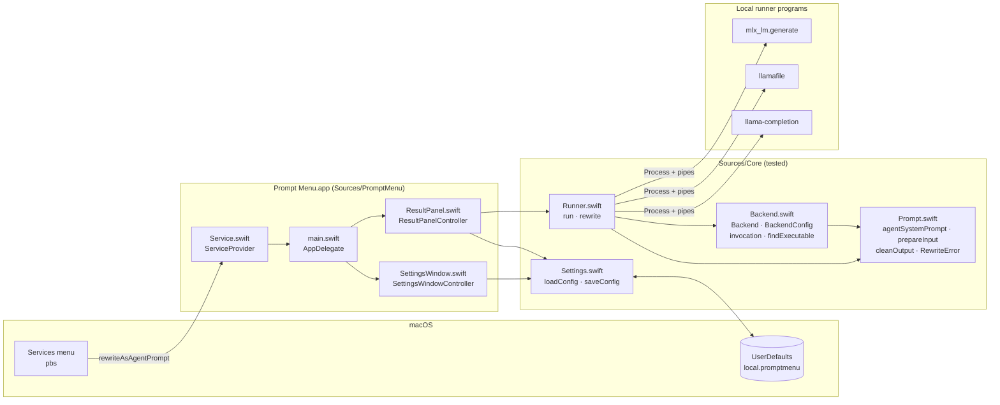
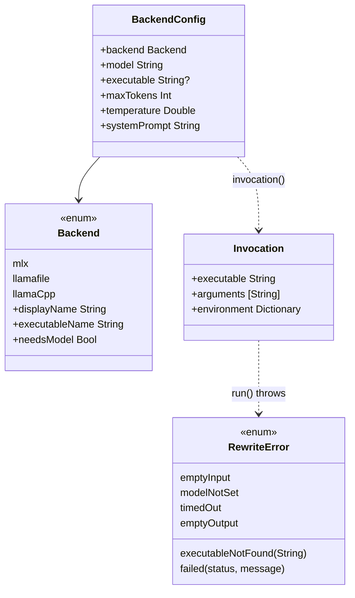

# Architecture

Prompt Menu is one small macOS app with no dependencies. It has two layers:

- **`Sources/Core`**: everything that can be tested without a screen. It covers the prompt, the command line for each runner, running a program, and settings. It uses only Foundation.
- **`Sources/PromptMenu`**: the AppKit shell. It covers the Services entry point, the result dialog, the settings window and the app lifecycle.

The tests compile `Tests/` together with `Sources/Core` only. Anything in `Sources/PromptMenu` is checked by building the app and running it by hand (see [DEVELOPMENT.md](DEVELOPMENT.md)).

## Files

| File | Owns | Depends on |
|---|---|---|
| `Sources/Core/Prompt.swift` | The built-in system prompt (`agentSystemPrompt`), input limits (`maxInputCharacters`, `prepareInput`), `combinedPrompt`, output cleanup (`cleanOutput`), errors and their messages (`RewriteError`), and the Services method name (`serviceMessage`). | Foundation |
| `Sources/Core/Backend.swift` | The runners (`Backend`), a run's settings (`BackendConfig`), the exact command line per runner (`invocation`), and finding programs (`findExecutable`, `standardSearchDirs`). | Prompt |
| `Sources/Core/Runner.swift` | Running a program with a timeout, streaming its stdout and reporting failures (`run`), plus the whole pipeline from text in to prompt out (`rewrite`). | Prompt, Backend |
| `Sources/Core/Settings.swift` | Reading and writing preferences (`loadConfig`, `saveConfig`), the default model, and the allowed ranges. | Backend |
| `Sources/PromptMenu/Service.swift` | `ServiceProvider`, the object macOS calls for the Services item. | Core |
| `Sources/PromptMenu/ResultPanel.swift` | One dialog per rewrite: spinner and timer, streamed text, Copy, Try Again and Close, and stopping the runner when closed. | Core |
| `Sources/PromptMenu/SettingsWindow.swift` | The settings window, which checks the runner live, and Try It. | Core |
| `Sources/PromptMenu/main.swift` | `AppDelegate`: wiring, the main menu, when to show settings, and quitting when idle. | everything |
| `Resources/App-Info.plist` | The bundle id, version, `LSUIElement`, and the **`NSServices`** entry that creates the menu item. | — |
| `scripts/build.sh` · `test.sh` · `install.sh` | Compiling with `swiftc`, running the tests, and installing and registering the app. | — |

## Key types

## How each runner is called

These command lines are the contract with each runner, and `Tests/BackendTests.swift` asserts them argument by argument.

| Backend | Program | Arguments | Environment |
|---|---|---|---|
| `mlx` | `mlx_lm.generate` | `--model M --system-prompt S --prompt TEXT --max-tokens N --temp T --verbose True` | `HF_HUB_OFFLINE=1 TRANSFORMERS_OFFLINE=1 PYTHONUNBUFFERED=1` |
| `llamafile` | `/bin/sh` + `llamafile` path | `[-m M] --cli -p "S\n\nText to rewrite:\nTEXT" -n N --temp T` | — |
| `llama.cpp` | `llama-completion` | `-m M -sys S -p TEXT -cnv -st --no-display-prompt --log-disable -n N --temp T` | — |

Why they differ:

- **MLX uses `--verbose True`** so tokens print as they're made. The text arrives between two `==========` lines and is followed by stats, and `cleanOutput` removes all of that. `PYTHONUNBUFFERED=1` stops Python from holding output back when stdout is a pipe. `HF_HUB_OFFLINE=1` guarantees no download.
- **llamafile runs under `/bin/sh`.** llamafiles are Actually Portable Executables, which start with a shell-script header that `posix_spawn` rejects. `--cli` is llamafile 0.10's one-shot mode. Its system-prompt support isn't documented, so the instructions are put in front of the text (`combinedPrompt`).
- **llama.cpp uses `llama-completion`**, the one-shot program. Newer `llama-cli` builds are interactive-only. `-cnv -st` applies the model's chat template for a single turn, and `-sys` sets the system prompt.

## Design decisions

| Decision | Why | Rejected alternative |
|---|---|---|
| Runners are separate programs, started fresh for each rewrite | No network code at all, no server to manage, and nothing left in memory after the dialog closes. | A local HTTP server (Ollama, `mlx_lm.server`, `llamafile --server`). It's faster on repeat runs, but it's network code and a long-running process. |
| A Services menu item, not a Finder extension | Services is macOS's built-in way to act on highlighted text in any app. A Finder Sync extension only sees files. | Finder extension, accessibility APIs reading the selection (they need a permission prompt), or a global hotkey that copies the selection. |
| No in-process MLX (mlx-swift) | Its Metal shaders only build with full Xcode, and this project builds with the Command Line Tools. | mlx-swift through SwiftPM. It's the best next step for users who have Xcode. |
| A plain `swiftc` build and a home-made test runner | No Xcode project to maintain, and XCTest isn't part of the Command Line Tools. Same approach as Finder Menu. | SwiftPM or an Xcode project. |
| The app quits when idle | Python and the model's memory are released, and there's nothing to keep updated. | Staying resident as a menu-bar app. |
| The built-in prompt is saved as `""` | A better prompt in a later version reaches everyone who didn't customize theirs. | Saving the full text. |
| `cleanOutput` is safe to run on partial text | It's called on every streamed chunk, so it never shows half of something it would remove later (such as an unclosed `<think>`). | Cleaning only at the end, which would flash runner noise while streaming. |

## Invariants

These are enforced by tests in `Tests/GuardrailTests.swift` and `Tests/ServiceTests.swift`:

1. **No network code** in `Sources/` (`testNoNetworkCode`).
2. **No entitlements and no `*UsageDescription` keys** (`testNoEntitlementsOrPermissions`).
3. **The Services wiring matches**: `NSMessage` in the plist equals `serviceMessage` and a method with that exact signature exists in `Service.swift` (`testServicesEntry`).
4. **The docs list every runner**: README.md and this file mention every `Backend.executableName` (`testDocsCoverEveryRunner`).
5. **Command lines are pinned**: every argument for each backend is asserted (`BackendTests`).

## Threading

- `ResultPanelController.start()` runs `rewrite` on a background queue (`.userInitiated`).
- `run` reads stdout and stderr through `readabilityHandler` on system queues, guarded by an `NSLock`. Progress callbacks arrive on those queues, and the panel hops to the main queue to update.
- Each run has a `generation` number. Results and progress from an older run (after Try Again, or after the dialog closed) are ignored.
- Closing the dialog or pressing Try Again calls `terminate()` on the running process. Quitting the app (⌘Q, logout, or SIGTERM, which `main.swift` turns into a normal quit) stops every panel's runner in `applicationWillTerminate`, so none is orphaned.
- `Process` starts each runner in its own process group, and `terminate()` stops that whole group. This also stops a llamafile, which runs as a child of `/bin/sh` (`testRunTimeout`).
