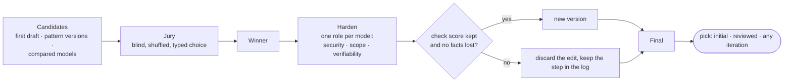

# Future features

Designed, not built. Each section says what it's for, how it would work inside Prompt Menu's rules (local only, no network code, no permissions, Command Line Tools only), what it would cost on an 8 GB Mac, and what's still open. Build them in the order listed; each one uses the pieces before it.

The rule for all of them: **highlight → right-click → first draft stays exactly as fast and simple as it is.** Everything here is an optional button in the dialog after the first draft.

- [1. Fill the gaps (optional wizard)](#1-fill-the-gaps-optional-wizard)
- [2. Compare models](#2-compare-models)
- [3. Review pipeline: jury, harden, iterations](#3-review-pipeline-jury-harden-iterations)
- [4. Send to a coding agent's CLI](#4-send-to-a-coding-agents-cli)
- [5. Project context](#5-project-context)
- [6. Smaller items](#6-smaller-items)
- [Where the ideas come from](#where-the-ideas-come-from)

---

## 1. Fill the gaps (optional wizard)

**For:** answering the model's `[CONFIRM: …]` questions without hunting through the text.

**How:**
- A **Fill Gaps…** button appears in the dialog only when the current version has at least one `[CONFIRM: …]`. Nothing opens on its own.
- It opens a sheet with one text field per question, labeled with the question. Every field is optional.
- **Apply** replaces each answered `[CONFIRM: question]` with the answer, without a model: instant and exact. Unanswered ones stay. The result is a new version, `N · Filled`.
- An optional **Polish** checkbox runs one model pass afterwards that smooths the wording, keeping every fact. With the model loaded, that takes a few seconds.

**Core:** `confirmQuestions(in:) -> [String]` and `fill(_ text:, answers:) -> String`, both pure and tested. The checker already counts CONFIRMs, so the badge updates.

**Cost:** none without Polish; one model run with it.

## 2. Compare models

**For:** finding which local model writes the best prompts for your kind of notes.

**How:**
- A **Compare Models…** button in the dialog, after the first draft.
- It lists the models on this Mac: MLX models found in `~/.cache/huggingface/hub` (folders `models--<org>--<name>` with MLX weights), and GGUF paths the user added in settings. The current model is ticked; the user ticks others.
- The models run **one at a time** with the same input and instructions, because two models don't fit in 8 GB together. The kept-loaded worker switches models between runs (it already reloads when the model changes).
- Results show side by side: text, time, and check score. **Use This** adds one as a version, labeled with the model's name.

**Core:** `localModels() -> [ModelRef]` (directory scan, testable with a temp folder). Comparison runs reuse `rewrite`.

**Cost:** about 10 s to load plus 7–15 s to generate per model with 3B models. Show the estimate before starting, and allow Stop.

## 3. Review pipeline: jury, harden, iterations

**For:** a prompt that several models agree is best, then hardened by each of them, with every step visible and the original always available.



**Jury, built like a decision model with controls for bias.** It follows decision-model-benchmark's typed choices and deterministic baselines:
- Each judge model sees the candidates as **A, B, C… in a shuffled order**, with model names and labels removed, and answers with **one letter and a confidence from 0 to 100** ("B 80"). Parsing reuses `parseChoice`.
- **No self-judging:** a model's vote doesn't count for the candidate it wrote.
- **Position bias check:** each judge votes twice with the order reversed. A vote counts only if both agree; otherwise that judge abstains. This doubles the jury's cost, so it's a setting, on by default.
- **Deterministic baseline:** the checker's ranking counts as one more vote, so a fluent but structurally broken prompt can't win on style.
- **Aggregation:** a Borda count weighted by confidence. Ties go to the higher check score.
- With only one model available, the jury is skipped and the checker picks the winner. The UI says so.

**Harden.** The winner gets one critique-then-edit pass per available model, each with a role. The roles come from your agentic-review reviewers and from patterns in the catalog:
- **Security & safety:** risky actions get an approval step; untrusted input stays out of control flow (Plan-Then-Execute, Lethal Trifecta).
- **Scope:** CONSTRAINTS name what not to touch; no invented requirements.
- **Verifiability:** DONE WHEN can be checked by a test, a command or a visible result (Spec-As-Test, Output Verification Loop).

Each pass writes at most five critique bullets, then edits. An edit is **kept only if the check score doesn't drop and no fact is lost**. This is the defensive rule from defensive-architect: repair or drop, never keep it broken. Rejected edits stay in the log.

**Iterations.** Every candidate, vote and edit is a `PromptVersion` (the dialog already keeps versions). A **Review Log** view shows the steps in order: who judged what, with what confidence, and what each hardening pass changed (a diff against its input). The user takes the initial draft, the final result, or anything in between. The log lives only in the dialog and isn't saved to disk.

**State:** a strict state machine (from agentic-tdd: illegal transitions rejected): `candidates → judging → hardening(role i) → done | stopped`. Stop is always available and keeps everything produced so far.

**Cost:** with two 3B models, about 6–8 model calls plus model switches, roughly 1.5–2.5 minutes. Show the estimate before starting.

**Open questions:** should a 3B model be allowed on the jury at all? Its pattern picks in testing were weak. One option is to require a 7B+ judge, or count small-model votes at half weight.

## 4. Send to a coding agent's CLI

**For:** taking the final prompt straight to Claude Code, Codex, Gemini CLI, Aider, opencode, Goose or any other agent CLI, in the right project folder.

**Design for CLIs that keep changing.** CLIs change their flags often, so nothing about them is hardcoded:
- **Harnesses are data.** `~/Library/Application Support/Prompt Menu/harnesses.json` holds entries like:
  ```json
  {"schema": 1, "harnesses": [
    {"name": "Claude Code", "program": "claude", "command": "claude \"$(cat {prompt_file})\""},
    {"name": "Aider", "program": "aider", "command": "aider --message-file {prompt_file}"}
  ]}
  ```
  Prompt Menu ships defaults, the user can edit or add entries, and a newer app version adds new defaults without overwriting the user's edits.
- **Detection:** an entry shows only if `program` is found with `findExecutable` (the same search as the runners), so the menu lists only what's installed.
- **The prompt never touches a shell string.** It's written to a temp file readable only by the user, and templates refer to it only as `{prompt_file}` (a path Prompt Menu creates, quoted). That keeps text from the prompt from running as a command.
- **Working folder:** chosen with a standard folder picker (no permission prompt), with recent folders remembered.

**Delivery without new permissions:**
- **Open in Terminal:** write a `.command` script (`cd {cwd}` plus the filled-in command), make it executable, and `open` it. Terminal runs it. No Apple Events or Automation permission is needed, unlike scripting Terminal directly.
- **Copy Command:** puts the filled-in command on the clipboard for any terminal.
- A **Send to ▾** button in the dialog lists the detected harnesses, then the folder.

**Tests:** template filling, quoting of paths with spaces and quotes, detection with fake programs in a temp folder, and that `{prompt_file}` is the only way prompt text reaches the command.

**Open questions:** which harnesses ship as defaults, and their exact flags. Check each CLI's current `--help` when building this, not from memory.

## 5. Project context

**For:** prompts that name the real files, commands and conventions of a project.

**Decision for now:** the context comes from the highlighted text, which works well for the end goal of the selected text. Explicit context is deferred.

**When it's built:** an optional **Add Project…** in the dialog picks a folder and reads `AGENTS.md`, `CLAUDE.md` and the README (first few thousand characters). Their headings and commands go into CONTEXT, marked as from the project. Nothing is read without the user choosing the folder. It pairs naturally with Send To (§4), which already asks for a folder.

## 6. Smaller items

- **Keep llama.cpp and llamafile loaded too.** Both have interactive modes over stdin, but their prompts and turn markers vary by version. A worker like `mlx_worker.py`, wrapping each in a stdin/stdout protocol, needs per-version testing against real models. Their server modes stay ruled out, since they're network code.
- **In-process MLX (mlx-swift)** for users with full Xcode: no Python, no worker. It needs a SwiftPM build path beside the plain `swiftc` one.
- **A model-picked pattern from all 203** with a larger model: two-stage (category, then pattern) to keep each choice small.
- **Pattern catalog refresh reminders** for developers: CI could warn when the snapshot is more than N months old (without fetching anything at run time).

## Where the ideas come from

| Source | Idea used |
|---|---|
| [nibzard/awesome-agentic-patterns](https://github.com/nibzard/awesome-agentic-patterns) | The pattern catalog (built). Plan-Then-Execute, Spec-As-Test, Output Verification and Lethal Trifecta shape the hardening roles. |
| [nibzard/decision-model-benchmark](https://github.com/nibzard/decision-model-benchmark) | Typed one-of-N choices with confidence, deterministic baselines, and checking consistency before trusting a vote: the jury design. |
| prompt-forge | Style templates (built) and the assembly line of stages (plan → review → execute → review): the pipeline's stage order. |
| agentic-review | Specialist reviewer roles: the hardening roles. |
| agentic-tdd | Confidence scores and a strict state machine with illegal transitions rejected: the pipeline's state. |
| defensive-architect | Repair or drop bad model output, never keep it broken: the keep-only-if-not-worse rule for edits. |
