# Flow maps

Diagrams of every path through Prompt Menu. They render on GitHub. Names in `code` are the real functions and types; see [ARCHITECTURE.md](ARCHITECTURE.md) for what each file owns.

1. [App launch: Services or settings](#1-app-launch-services-or-settings)
2. [Service call to dialog](#2-service-call-to-dialog)
3. [The rewrite pipeline](#3-the-rewrite-pipeline)
4. [Choosing the runner and building the command](#4-choosing-the-runner-and-building-the-command)
5. [Running a program: streaming, timeout, failure](#5-running-a-program-streaming-timeout-failure)
6. [Cleaning the output](#6-cleaning-the-output)
7. [Dialog states](#7-dialog-states)
8. [Errors and what the user sees](#8-errors-and-what-the-user-sees)
9. [Settings: load, edit, save](#9-settings-load-edit-save)
10. [App lifetime: when it quits](#10-app-lifetime-when-it-quits)
11. [Install and registration](#11-install-and-registration)
12. [Development loop](#12-development-loop)

---

## 1. App launch: Services or settings

macOS starts the app when the Services item is chosen and it isn't already running. If no service request arrives within half a second, the user opened the app directly, so it shows settings.

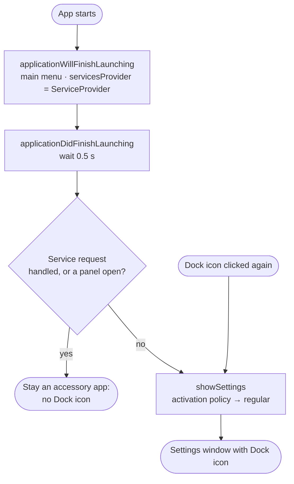

## 2. Service call to dialog

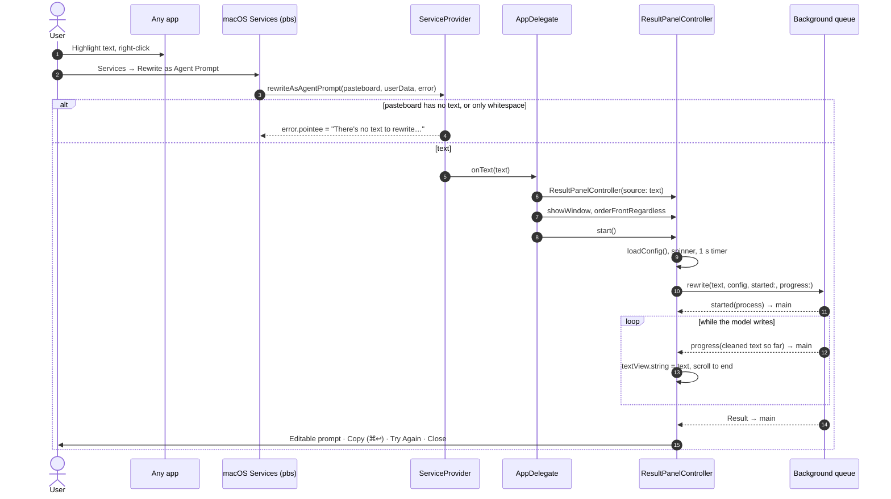

## 3. The rewrite pipeline

`rewrite(_:config:searchDirs:timeout:started:progress:)` in `Runner.swift` is the only entry point the UI uses.

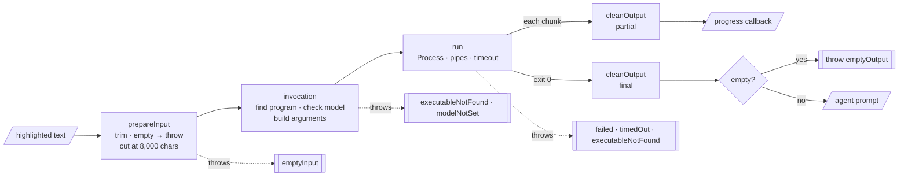

## 4. Choosing the runner and building the command

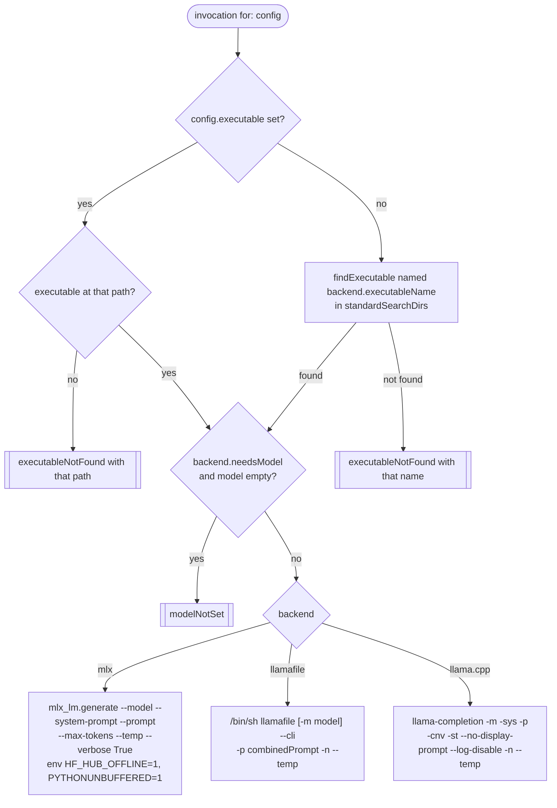

Search order in `standardSearchDirs`: `/opt/homebrew/bin` → `/usr/local/bin` → `~/.local/bin` → `~/bin` → `~/Library/Python/*/bin` (newest first) → `$PATH`, without duplicates.

## 5. Running a program: streaming, timeout, failure

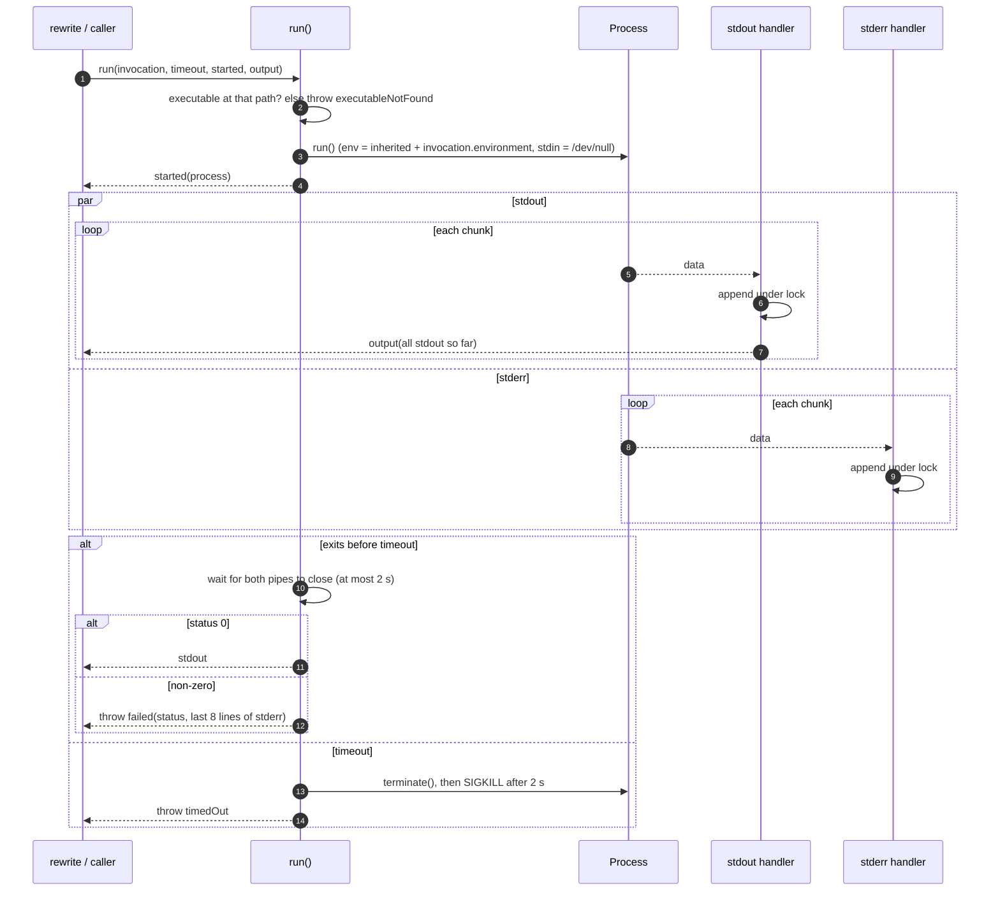

The 2-second cap on waiting for the pipes covers a runner that leaves a child process holding stdout open. `testRunnerChildKeepsPipeOpen` tests it.

## 6. Cleaning the output

`cleanOutput` runs on every streamed chunk and again on the final text, so each step must also be safe on partial text.

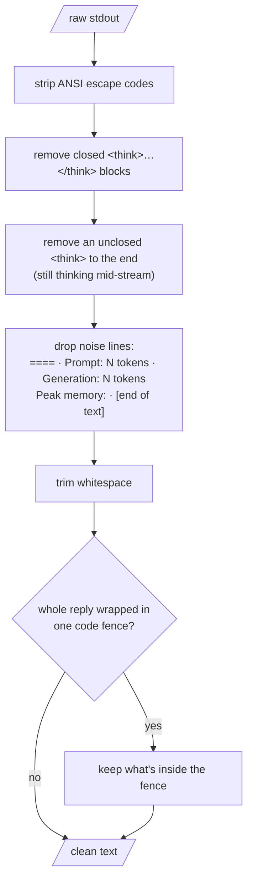

## 7. Dialog states

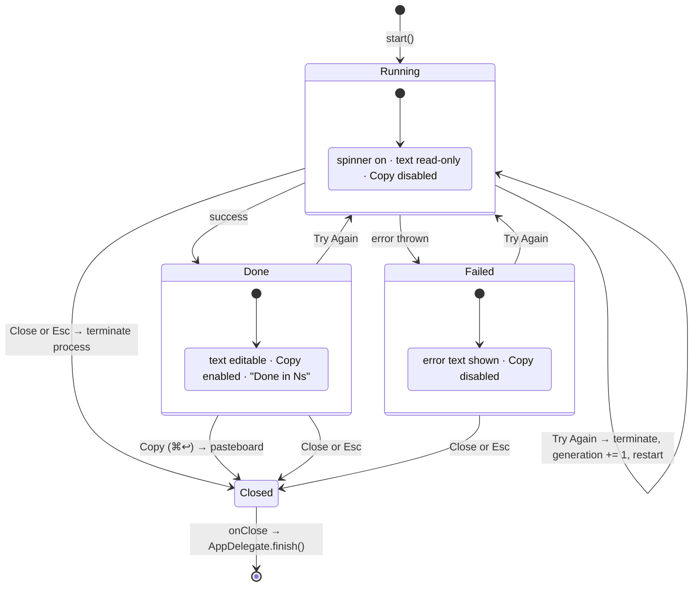

## 8. Errors and what the user sees

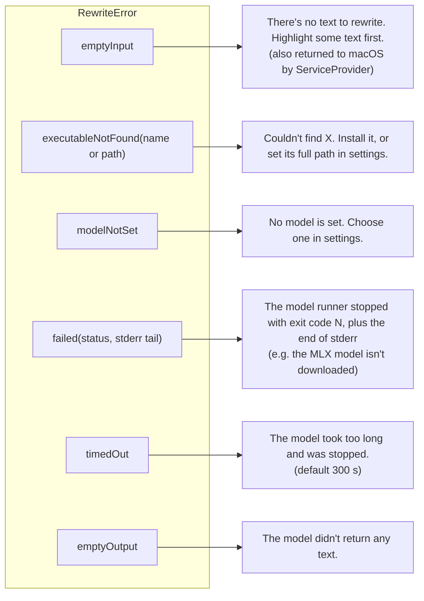

All of these appear in the dialog's text area with Copy turned off. Try Again re-reads the settings, so you can fix the setting and retry without closing the dialog.

## 9. Settings: load, edit, save

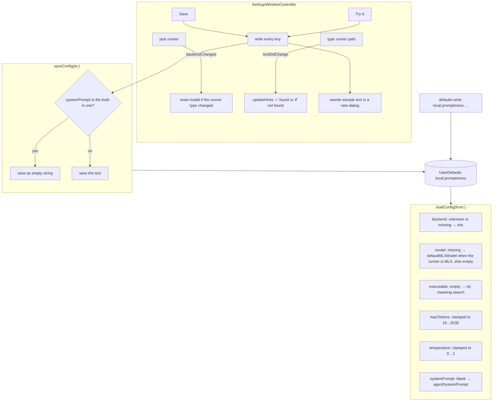

## 10. App lifetime: when it quits

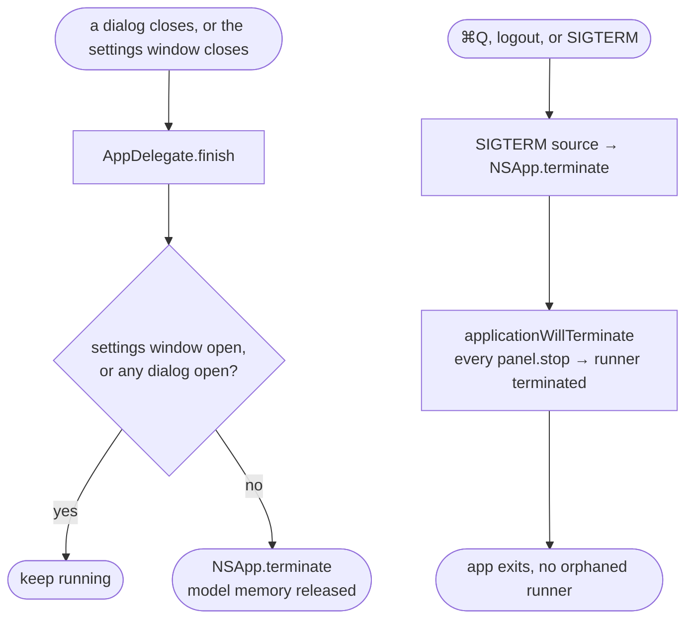

## 11. Install and registration

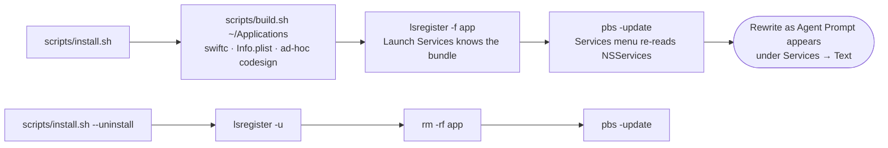

## 12. Development loop

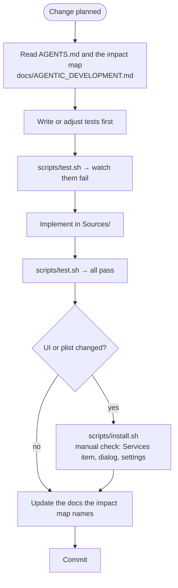
